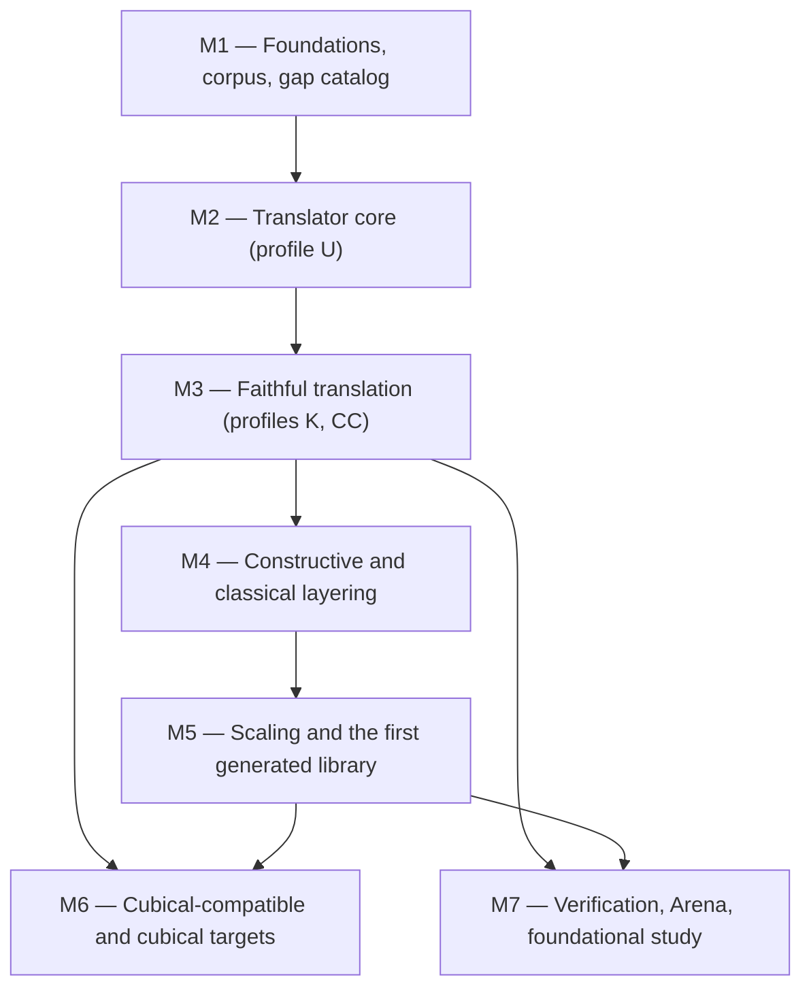
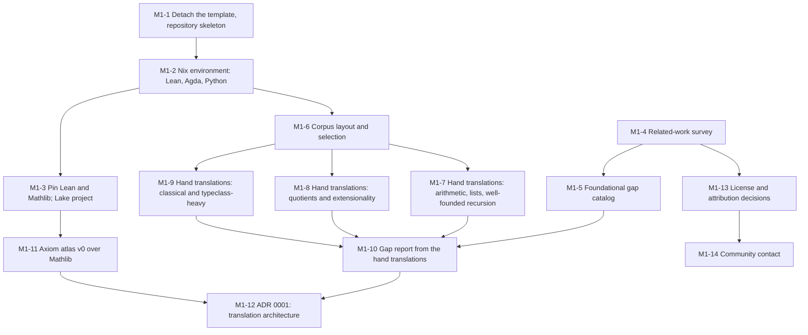
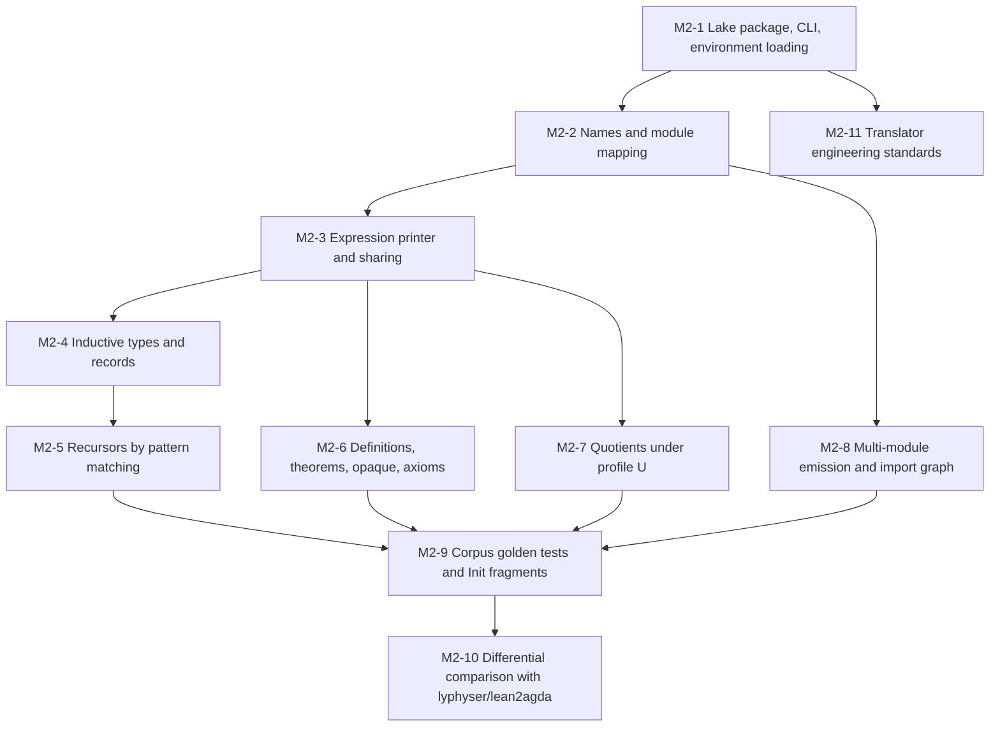
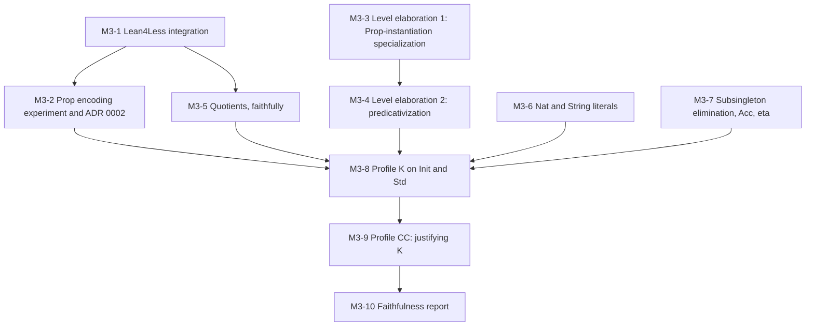
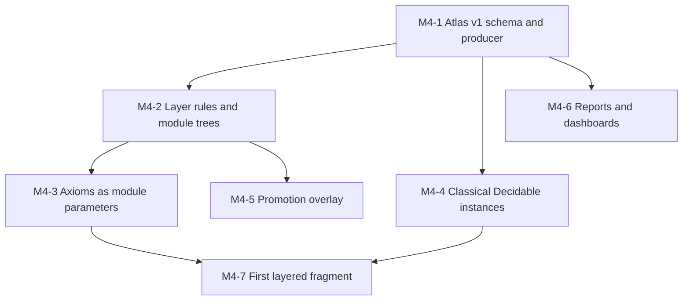
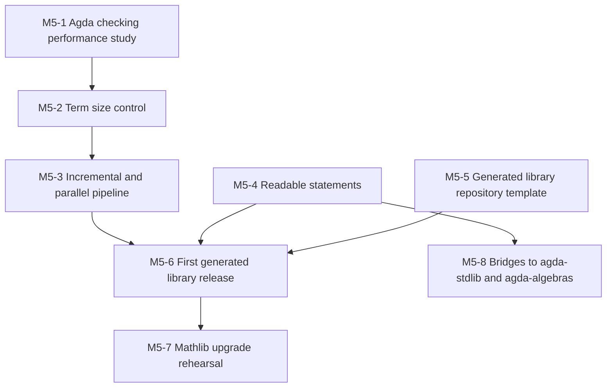
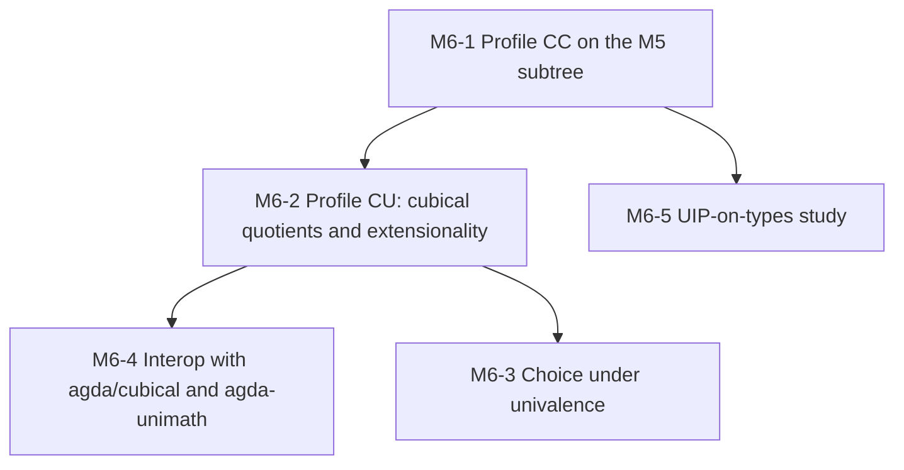
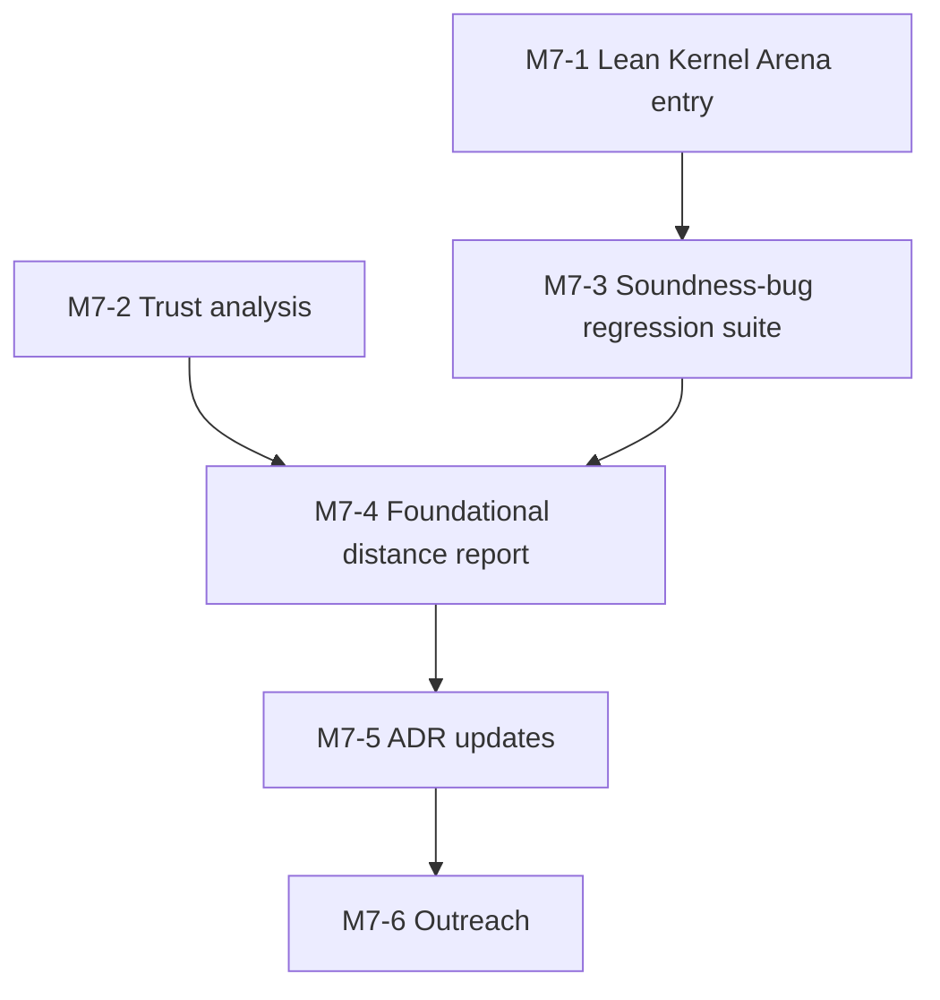

<!--
File: docs/GITHUB_PROJECT.md

The lean2agda project roadmap: milestones, labels, issues, and the
dependency graphs between them.  Structure lives here; state (issue
numbers, open/closed, assignees) lives on GitHub.

This file is partially generated by the github-project engine.  Manual
prose (everything outside the marked regions: summary, design overview,
milestone descriptions, exit criteria, dependency graphs) is hand-edited.
Issue listings between

    BEGIN GENERATED: milestone-N
    ...
    END GENERATED: milestone-N

markers are regenerated from GitHub state by `make update`; edits to
those regions will be overwritten on the next update.  After the first
`make populate`, issue bodies are edited ON GITHUB.

Grammar notes for editors: the engine requires the em-dash in
`### Milestone N — Title` headings and in the `## Labels` entries, and
the exact spellings `**Labels:**` and `**Milestone:**` on the metadata
lines of an issue.  Those are structural tokens, not prose.
-->

# lean2agda: GitHub Project Roadmap

**Project Title**:  lean2agda: a Lean 4 to Agda translator and the libraries it produces

**Repository**:  `formalverification/lean2agda`

**Date**:  2026-10-04

---

## Summary

Build a translator from Lean 4 to Agda and use it to grow large Agda
mathematics libraries out of Lean's, Mathlib first.  The translation is
faithful (proof terms are translated and re-checked by Agda, never
trusted), sorts the result into a constructive layer and a classical
layer, and records for every declaration which features of Lean's type
theory it needed that Agda's does not provide.  Seven milestones: the
foundations, corpus and gap catalog (M1); the translator core on an
unsafe scaffolding profile (M2); faithful translation of proof
irrelevance, universes and quotients (M3); constructive and classical
layering (M4); scaling to Mathlib fragments and the first generated
library (M5); the cubical-compatible and cubical targets (M6); and
verification, a Lean Kernel Arena entry and the foundational study
(M7).

---

## Description

### Goals

The project has the following three goals, in priority order:

1. **Libraries**.  Mathlib holds roughly 138,000 definitions and
   290,000 theorems; no Agda library is within an order of magnitude of
   that.  The translator should let Agda users consume Lean
   developments as Agda libraries, with readable statements and
   machine-checked proofs, split so that users of `--safe
   --cubical-compatible` Agda who want constructive mathematics get a
   library that never mentions a classical axiom.
2. **Foundations**.  Lean's theory (an impredicative, proof-irrelevant
   Calculus of Inductive Constructions with primitive quotients and
   three axioms) and Agda's (predicative Martin-Löf type theory, with
   or without K, optionally cubical) differ in ways that are known in
   principle but unmeasured in practice.  Every failed or repaired
   translation is a data point; the project publishes the measurements.
3. **Confirmation**.  A proof that Agda accepts after translation has
   been checked by a second system with a different kernel and a
   different theory.  A proof that cannot be translated is either a
   translator limitation, a genuine foundational gap, or a problem in
   the Lean development; the pipeline separates those outcomes.

### Architecture at a glance

The translator is a Lean 4 program operating on the elaborated Lean
environment (the `.olean` files Lake builds), the approach of every
serious predecessor (lyphyser's `lean2agda`, Deducteam's `lean2dk` and
`Lean4Less`).  It runs in the following stages:

1. **Profile**.  For every constant, record the axioms it depends on
   (`propext`, `Quot.sound`, `Classical.choice`, `Lean.ofReduceBool`,
   `sorryAx`), its computability, and the kernel features its typing
   used.  This is the atlas; the layering in M4 is computed from it.
2. **Normalize**.  Run Lean4Less (Deducteam) to replace Lean's
   definitional proof irrelevance and K-like reduction with explicit
   casts, yielding terms typeable in the smaller theory Lean⁻, and
   extend the same mechanism to the definitional computation rule of
   `Quot.lift` where the target has no definitional quotients.
3. **Elaborate universes**.  Specialize each constant by which of its
   universe parameters are instantiated at `Prop`, then compute
   predicative, universe-polymorphic Agda level annotations by
   constraint solving in the style of Felicissimo and Blanqui's
   Predicativize.  Constants that use impredicativity in an essential
   way are reported, not translated.
4. **Emit**.  Print one Agda module per Lean module and layer:
   inductive types as `data` or `record`, recursors as pattern-matching
   definitions, theorems in `opaque` blocks, axioms as module
   parameters, with `.agda-lib` files and an import graph.
5. **Check**.  Run Agda under the profile's flags; feed every failure
   back into the atlas with its category.

### Target profiles

A profile is the set of Agda flags the output must check under, plus
the list of what remains a module parameter.  The profiles are as
follows:

| Profile | Agda flags | What stays a parameter | Purpose |
| --- | --- | --- | --- |
| U | `--type-in-type`, postulates allowed | nothing (postulated) | scaffolding only; never a deliverable |
| K | `--safe` (Agda's default, with K) | `propext`, quotients, `funext`, `Classical.choice` | the faithful target: every rule of Lean's theory has a counterpart |
| CC | `--safe --cubical-compatible` | as K | the primary deliverable; uses of K must be justified by `isSet` proofs |
| CU | `--safe --cubical` | `Classical.choice` only, and only in forms consistent with univalence | quotients, `funext` and `propext` become theorems; constructive layer first |

### Layers

Lean's `#print axioms` sorts declarations into tiers: T0 (no axioms),
T1 (`propext` and/or `Quot.sound`, both validated by univalent type
theory), T2 (`Classical.choice`), T3 (`Lean.ofReduceBool`, `sorryAx`,
`unsafe` or `partial` definitions).  The emitted library has a
**Constructive** layer (T0 and T1) and a **Classical** layer (T2) that
imports it; T3 is refused and reported.  Both layers are `--safe`:
the classical principles are record-typed module parameters in the
style of TypeTopology, and a one-line user module may postulate them
for anyone who prefers that.

### Where the results live

This repository holds the translator, the hand-translated corpus that
serves as its test oracle, the atlas tooling, and the documentation.
Generated libraries are not committed here: each translated Lean
library gets its own repository (one per source library) with
provenance (Lean version, Mathlib revision, translator version,
profile), its own CI, and Mathlib's Apache-2.0 license.  The first such
repository is created at the end of M5, not before; until then the
corpus in this repository is the main Agda output under version
control, beside the translator's golden tests (M2-1, M2-9).

### Working agreements

Python follows the functional house style (total functions, `Result`
values, frozen dataclasses, a `File:` header in every file, a test for
every pure function); Lean code keeps a pure translation core with IO at
the edges; Agda output targets Agda 2.8.0 with agda-stdlib 2.3 and the
cubical library 0.9 as pinned by the Nix flake.  Design decisions are
recorded as ADRs under `docs/adr/` with companion notes beside the
component they describe.

---

## Labels

The `milestone-N-*` labels are load-bearing: populate attaches them, and
update uses them to decide which generated region an issue belongs to.
The other labels are topic labels.

- `milestone-1-foundations` (0075ca) — Milestone 1: Foundations, corpus, and gap catalog.
- `milestone-2-translator-core` (0075ca) — Milestone 2: Translator core on the scaffolding profile.
- `milestone-3-faithful` (0075ca) — Milestone 3: Faithful translation of proof irrelevance, universes, and quotients.
- `milestone-4-layering` (1d76db) — Milestone 4: Constructive and classical layering.
- `milestone-5-scale` (1d76db) — Milestone 5: Scaling to Mathlib fragments and the first generated library.
- `milestone-6-cubical` (5319e7) — Milestone 6: Cubical-compatible and cubical targets.
- `milestone-7-verification` (5319e7) — Milestone 7: Verification, the Kernel Arena, and the foundational study.
- `translator` (c2e0c6) — The Lean-side translator and its passes.
- `agda-output` (bfd4f2) — The emitted Agda: modules, libraries, readability.
- `foundations` (d4c5f9) — Type-theoretic questions about what translates and why.
- `classification` (fef2c0) — The atlas: constructive, classical, refused.
- `performance` (f9d0c4) — Time and memory of translation and of Agda checking.
- `infrastructure` (ededed) — Nix, CI, Makefile, repository tooling.
- `documentation` (0e8a16) — Documentation, ADRs, reports.
- `research` (c5def5) — Open-ended investigation whose outcome is a finding, not a feature.
- `upstream` (fbca04) — Coordination with the Lean, Agda, and Deducteam communities.
- `hand-translation` (e99695) — Corpus entries translated by hand.
- `decision` (b60205) — Needs a decision recorded in an ADR before implementation.
- `good first issue` (7057ff) — Small and self-contained.

---

## Milestones

### Milestone 1 — Foundations, corpus, and gap catalog

**Description:**

Set the project up and learn what translation involves before writing a
translator.  Detach the template, build the Nix environment with Lean
and Agda, pin the first Lean and Mathlib revisions, write the
related-work survey and the catalog of foundational gaps between the
two theories, translate a dozen Mathlib declarations by hand into
idiomatic Agda, measure which axioms Mathlib's declarations depend on,
and record the architecture decision as ADR 0001.

**Exit criterion:**

`nix develop` provides Lean, Agda and Python on a fresh machine; twelve
corpus entries are translated by hand and type-check under `--safe
--cubical-compatible`; an atlas report over the pinned Mathlib
revision gives the axiom-tier counts; ADR 0001 is accepted and the
license decision is recorded.

---

### Milestone 2 — Translator core on the scaffolding profile

**Description:**

Build the mechanical parts of the translator on the unsafe profile U
(`--type-in-type`, postulates allowed), where universe levels and
definitional proof irrelevance cannot yet fail: environment loading,
names, expressions, inductive types and records, recursors,
definitions and theorems, quotients, and multi-module emission.  Prove
the machinery on the corpus and on fragments of Lean's `Init`, and take
the first Agda performance baseline.

**Exit criterion:**

Every corpus entry and the modules `Init.Prelude`, `Init.Core`,
`Init.Data.Nat.Basic` and `Init.Data.Nat.Gcd` translate and are
accepted by Agda under profile U; golden tests pass in CI; time and
memory per emitted module are recorded.

---

### Milestone 3 — Faithful translation

**Description:**

Replace the scaffolding with the real thing: integrate Lean4Less to make
proof irrelevance and K-like reduction explicit, choose the encoding of
Lean's `Prop` by experiment, implement universe-level elaboration
(instantiation specialization and predicativization), translate
quotients, literals, subsingleton elimination and eta faithfully, and
deliver profile K (`--safe`) followed by a first measurement of profile
CC (`--safe --cubical-compatible`).

**Exit criterion:**

`Init` and `Std` translate under profile K with no postulates and are
accepted by Agda under `--safe`; the faithfulness report states, by
category, what fraction of their declarations translates under K and
under CC and why the rest does not; ADR 0002 records the `Prop`
encoding decision with the measurements that earned it.

---

### Milestone 4 — Constructive and classical layering

**Description:**

Turn the atlas into the shape of the output.  Define the layer
assignment rules (tiers T0 through T3), emit the Constructive and
Classical module trees with the classical principles as module
parameters, detect classical `Decidable` instances and experiment with
abstracting them away, build the overlay mechanism by which a
hand-written constructive proof promotes a classical-layer theorem, and
publish the first layered Mathlib fragment.

**Exit criterion:**

A named Mathlib fragment (the import closure of `Mathlib.Order.Lattice`
and `Mathlib.Algebra.Group.Basic`, or a documented substitute) is
emitted as two `--safe` layers under profile K and accepted by Agda;
the report lists every declaration with its tier, its layer, and the
reason for any refusal.

---

### Milestone 5 — Scaling to Mathlib fragments and the first generated library

**Description:**

Make the pipeline regenerable and affordable at Mathlib scale: measure
and fix Agda checking cost, control term size with sharing and auxiliary
constants, cache and parallelize, make statements readable (notation,
implicit arguments, docstrings, literate output), define the generated
library repository template, rehearse a Mathlib upgrade, and build
bridges to the Agda standard library and agda-algebras.  Release the
first generated library as its own repository.

**Exit criterion:**

One command regenerates a named Mathlib subtree from a pinned revision;
its Agda check runs in CI within a stated budget; the result is
published as a separate repository with provenance and Apache-2.0
notices, and is listed in `docs/libraries.md`.

---

### Milestone 6 — Cubical-compatible and cubical targets

**Description:**

Complete the primary deliverable, profile CC, by inferring `isSet`
proofs wherever a use of K must be justified and reporting the uses
that cannot be; then build profile CU on `--cubical`, where quotients
are higher inductive types and function and propositional
extensionality are theorems, for the constructive layer; and study
which forms of choice the classical layer can keep under univalence.

**Exit criterion:**

The constructive layer of the M5 subtree is accepted by Agda under
`--safe --cubical-compatible`; the K-essential declarations are
enumerated with reasons; a fragment checks under `--safe --cubical`
with no parameters at all; the study of choice under univalence is
written up.

---

### Milestone 7 — Verification, the Kernel Arena, and the foundational study

**Description:**

Make the confirmation goal concrete.  Enter the translator plus Agda as
a checker in the Lean Kernel Arena (accept valid exports, reject
invalid ones, decline what cannot be expressed), analyze what the
pipeline trusts, build a regression suite from known kernel soundness
bugs, synthesize the measurements into a report on the practical
distance between the two foundations, update the design records, and
take the results to the Lean, Agda and Deducteam communities.

**Exit criterion:**

The Arena lists the entry with its results; `docs/trust.md` names every
trusted component; the soundness-bug suite passes; a report or preprint
is written; the ADRs are current.

---

### Milestone dependencies

Hand-authored; update never touches it.  M6 and M7 both build on M3;
M7's Arena entry needs the scale work of M5 for its performance tests.

### Dependencies between issues

One graph per milestone; an edge `A --> B` means B needs A.  Issues not
shown in a graph depend only on the milestone's entry conditions.

---

## Issues

Each issue below carries its milestone, labels, and a body ready for
GitHub.  On first populate, the `[MN-k]` ID in each heading becomes a
`[MN-k]` title prefix on GitHub, the join key that keeps re-runs
idempotent, and the new issue number is written back into the heading
as a `(#N)` suffix.  Dependencies on other issues are stated in the
body by ID.

## Milestone 1 — Foundations, corpus, and gap catalog

<!-- BEGIN GENERATED: milestone-1 -->

### Issue M1-1: Detach the template and lay out the repository skeleton (#1, closed)

**Labels:** `milestone-1-foundations`, `infrastructure`

## Description

The repository was created from the github-project template and still carries the engine copy, the template README, and the template CLAUDE.md.  Detach it, merge the consumer flake into the project flake (M1-2), and lay out the directories the roadmap assumes so that later issues have a place to land.

## Tasks

- [x] Run `make init`, commit the detached tree, and pin the engine with `nix flake lock` once the project flake exists.
- [x] Replace the template `CLAUDE.md` with project guidance: build and check commands, repository architecture, the house style, and the pointer to this roadmap.
- [x] Create the directories `translator/` (the Lean package), `corpus/`, `atlas/`, `scripts/python/`, `docs/adr/`, `docs/foundations/`, each with a `README.md` stating its purpose.
- [x] Extend the Makefile with placeholder targets `check`, `test`, `corpus-check`, `atlas`, each printing what it will do until the implementing issue lands; keep `make help` current.
- [x] Keep the shipped CI workflow and the freshness workflow; confirm `make lint` passes on this file.

## Acceptance criteria

- [x] `scripts/gh_project_populate.py` is absent and `make engine-mode` prints `path` inside `nix develop`.
- [x] `make help` lists every target with a one-line description.
- [x] The committed README is the project README (M1-4 writes the related-work section; the draft from the planning session is the starting point).

---

### Issue M1-2: Nix development environment with Lean, Agda, and Python (#2, closed)

**Labels:** `milestone-1-foundations`, `infrastructure`

## Description

Every tool the project needs must come from one `nix develop`, as in agda-native-air and agda-algebras: no system Agda, no system Lean.  Agda comes from nixpkgs (Agda 2.8.0, agda-stdlib 2.3, cubical 0.9 at the time of writing), Lean from the `lean4-nix` flake reading the project's `lean-toolchain` file (binary toolchain, so no source build), Python 3 from nixpkgs with no third-party packages, plus `gh`, `gnumake`, `jq`, and the github-project engine.

## Tasks

- [x] Write `flake.nix` with inputs `nixpkgs`, `lean4-nix`, and `github-project`; shells `default` (everything), `agda` (Agda and its libraries, without Lean), `lean` (the Lean toolchain, without Agda); all three carry make, git and Python, and only `default` carries the roadmap tools (gh, jq, the engine).
- [x] Register agda-stdlib and cubical in a project-local `AGDA_DIR` with a generated `libraries` file and an `agda` wrapper function, following the agda-algebras flake; allow optional external libraries (agda-unimath, TypeTopology) through `*_ROOT` environment variables as agda-native-air does.
- [x] Reuse the `formalverification` Cachix cache for the Agda toolchain and prebuilt library interfaces (declared in `nixConfig`; pushing to the cache from CI is part of the CI task below).
- [x] Add `make doctor`: prints the versions of `lean`, `lake`, `agda`, `python3`, confirms the libraries resolve, and fails if any is missing.
- [x] Document the setup in the README's development section.
- [x] Make CI enter the same shell for the Agda and Lean lanes (the shipped workflow lints the plan with setup-python and needs no Nix; the Nix job runs `make doctor`, whose two Agda probes are the first Agda check, and later Agda and Lean checks join that job).

## Acceptance criteria

- [x] On a machine with only Nix, `nix develop --command make doctor` succeeds and prints Agda 2.8.0 and the Lean version named in `lean-toolchain`.  (Verified 2026-10-04 on a development machine with every tool resolved from the Nix store, and 2026-10-05 by the CI job below on a fresh runner, with `--ignore-environment` hiding the runner's own tools.)
- [x] The shell's `agda` resolves both libraries for a file outside any `.agda-lib` project (the two probes `make doctor` runs).
- [x] CI enters the same shell (the Cachix cache keeps the job under fifteen minutes).  (Cold, with nothing of the lane in Cachix, the job took 8 min 43 s and 3 min 26 s in two attempts of run 37303222343; the cache only shortens warm runs.)

---

### Issue M1-3: Pin the Lean toolchain and Mathlib revision; Lake project (#3, closed)

**Labels:** `milestone-1-foundations`, `infrastructure`

## Description

Mathlib's toolchain moves monthly, and the tools we depend on (Lean4Less, lean2dk) each track their own Lean version.  A translation campaign must pin one Lean version and one Mathlib revision and upgrade deliberately.  Create the Lake project that carries Mathlib as a dependency, fetch its prebuilt `.olean` cache, and write the pinning policy.

## Tasks

- [x] Create `translator/` as a Lake package whose `lakefile` requires Mathlib at a pinned revision; write `lean-toolchain` to match Mathlib's.  lean4-nix carries one manifest per stable Lean release and lags Lean by about one release, so the Mathlib revision to pin is the Mathlib tag matching the newest Lean that lean4-nix knows (the repository's `lean-toolchain` already names it), not master.
- [x] Document `lake exe cache get` as the way to obtain Mathlib's `.olean` files, and where they live (`.lake/`, gitignored).
- [x] Write `docs/pinning.md`: what is pinned (Lean, Mathlib, Lean4Less fork, Agda, agda-stdlib, cubical), where each pin lives, and the upgrade procedure (rehearsed in M5-7).
- [x] Record the Lean4Less toolchain requirement next to Mathlib's so the skew between them is visible.
- [x] Require lean4export in the same package at its release tag nearest the pinned Lean (v4.33.0; it has no v4.33.1 tag), since the corpus entries record each declaration's exported kernel term; it runs as `lake exe lean4export`.

## Acceptance criteria

- [x] `lake build` in `translator/` succeeds inside `nix develop` with Mathlib's cache and no source rebuild of Mathlib.  (Verified 2026-10-05.  `lake build` compiles the one module of `Lean2Agda`, which imports nothing, so `make lean-smoke` adds the check that matters: `lake build --no-build Mathlib` reports all 8705 jobs of Mathlib and its dependencies up to date, compiling nothing, and exits with status 3 once a Mathlib source file changes.)
- [x] `docs/pinning.md` names every pin and the command that changes it.

---

### Issue M1-4: Related-work survey (#4, closed)

**Labels:** `documentation`, `milestone-1-foundations`, `research`, `upstream`

## Description

The planning session found substantial prior work: lyphyser's proof-of-concept `lean2agda` (2023 to 2024, Apache-2.0, needs `--type-in-type`), Deducteam's `Lean4Less` and `lean2dk` with Vaishnav's 2026 thesis on translating Lean to Dedukti, Gaëtan Gilbert's `rocq-lean-import`, Felicissimo and Blanqui's `Predicativize` (Matita's arithmetic library translated to `--safe` Agda), `lean4export` and the Lean Kernel Arena, `hol2dk` as a library-scale precedent, and the Mathlib axiom-dependency measurements.  Write it up as `docs/related-work.md` so that every later design discussion can cite it, and decide the project's relationship to lyphyser's tool.

## Tasks

- [x] For each predecessor: what it translates, how (environment or export file, Dedukti or direct), how it handles `Prop`, universes, proof irrelevance and quotients, what scale it reached, its license and activity, and what we take from it.
- [x] Record the quantitative anchors with their sources: Lean4Less's cast overhead on `Std` and on `Mathlib.Algebra.Order.Field.Rat`, rocq-lean-import's stdlib and mathlib runs, Predicativize's 32-minute Matita translation, the Arena's Mathlib checking times.
- [ ] Decide and record whether to reuse code from lyphyser/lean2agda (Apache-2.0) and how to credit it; contact the author (M1-14).
- [x] Note the open question of the Dedukti route (Lean4Less, lean2dk, Predicativize, then Agda) as a baseline to compare against once lean2dk matures.

## Acceptance criteria

- [x] `docs/related-work.md` exists with one section per predecessor and a reference list with URLs.
- [x] The README's related-work section links to it and agrees with it.

---

### Issue M1-5: Foundational gap catalog (#5)

**Labels:** `documentation`, `milestone-1-foundations`, `foundations`

## Description

Write `docs/foundations/gap-catalog.md`: one entry per feature of Lean's kernel theory, stating the Lean rule, Agda's status under each profile (U, K, CC, CU), the translation strategy, the predecessors' treatment, and references.  The catalog is the checklist the translator is built against and the vocabulary of the atlas.

## Tasks

- [x] Entries for: impredicative `Prop` (and `imax`); definitional proof irrelevance; K-like reduction and UIP; large elimination from `Prop` for subsingletons (`Eq`, `HEq`, `Acc`, `And`, `True`, `False`); structure eta and unit eta; primitive quotients and their computation rule; `Nat` literals with GMP-accelerated kernel operations and `String` literals; universe polymorphism and level arithmetic; the axioms `propext`, `Quot.sound`, `Classical.choice`; `Decidable` and `noncomputable`; the trust escape hatches (`Lean.ofReduceBool`, `implemented_by`, `partial`, `unsafe`, `sorryAx`); nested and mutual inductives; projections and `let`.
- [x] For each: Agda's rule or absence, with the documentation link (`--prop` restricts elimination from `Prop` to absurd patterns; `--safe` disables postulates; `--cubical-compatible` implies `--without-K`).
- [x] State the two facts that shape the profiles: Lean's theory proves UIP for every type, so a translation to `--cubical-compatible` Agda must justify each use of K by an `isSet` proof; and global choice of Lean's `Classical.choice` form is inconsistent with univalence, so the classical layer cannot live under `--cubical` unchanged.
- [x] Cite Carneiro's thesis on Lean's type theory, Abel and Coquand on the failure of normalization, Vaishnav's thesis, and the HoTT book for the choice argument.

## Acceptance criteria

- [x] Every entry has all five fields filled in.
- [ ] The catalog is linked from the README and from ADR 0001.

---

### Issue M1-6: Corpus layout, selection, and checker (#6)

**Labels:** `milestone-1-foundations`, `infrastructure`, `hand-translation`

## Description

The corpus is the set of Lean declarations we translate by hand first and that the translator must later reproduce.  Define its layout and manifest, select the twelve entries so that the gap catalog's features are each exercised at least once, and write the checker that runs Agda on every entry.

## Tasks

- [x] Layout `corpus/<id>/`: `lean/` (the Lean statement and its elaborated term, exported with lean4export), `agda/` (the hand-written idiomatic Agda, with its `OPTIONS` pragma), and `notes.md` (what the translation needed, by gap-catalog entry).
- [x] Manifest `corpus/manifest.json`: id, Lean name, Mathlib module, axiom tier, features exercised, Agda profile the hand version checks under, status.
- [x] Select the entries across these themes: constructive arithmetic and lists; well-founded recursion (`Nat.gcd`); a `Quot`-based lemma (`Multiset`); set extensionality (`propext`, `funext`); a `Finset` lemma whose statement carries a classical `Decidable` instance; a `Real` lemma; Lagrange's theorem; a lattice lemma (Knaster and Tarski); a structure-eta reliance (`Subtype`); and a `Mathlib.ModelTheory` lemma that touches agda-algebras's domain.
- [x] `scripts/python/corpus_check.py` (functional house style) runs `agda` on each entry under its declared flags and prints a table; wire `make corpus-check`.

## Acceptance criteria

- [x] The manifest lists twelve entries with their themes and features.
- [x] `make corpus-check` runs and reports per-entry status, in CI too.

---

### Issue M1-7: Hand translations: arithmetic, lists, and well-founded recursion (#7)

**Labels:** `milestone-1-foundations`, `hand-translation`

## Description

Translate by hand the constructive entries of the corpus: a `Nat` lemma (`Nat.gcd_self` or similar, the example lyphyser's tool handled), a `List` lemma, and the definition of `Nat.gcd` by well-founded recursion with one of its defining equations.  Write each in idiomatic Agda against agda-stdlib under `--safe --cubical-compatible`, and record what the kernel term needed that the idiomatic version did not.  Depends on M1-6.

## Tasks

- [ ] Export each declaration's kernel term with lean4export and record its size (nodes, bytes) in `notes.md`.
- [ ] Write the idiomatic Agda versions; note where agda-stdlib already has the result and whether the statements match up to notation.
- [ ] For `Nat.gcd`: document that Lean's kernel needs K-like reduction for its defining equation to hold definitionally (the reason Lean4Less aborts on large `Nat.gcd` computations) and how the Agda version avoids the issue.
- [ ] Record uses of proof irrelevance, K, literals, and `WellFounded` in the kernel terms.

## Acceptance criteria

- [ ] All entries of this theme check under `--safe --cubical-compatible` via `make corpus-check`.
- [ ] Each `notes.md` cross-references the gap catalog entries it exercised.

---

### Issue M1-8: Hand translations: quotients and extensionality (#8)

**Labels:** `milestone-1-foundations`, `foundations`, `hand-translation`

## Description

Translate by hand a `Multiset` lemma (Lean's `Quot` over list permutation) and a set-extensionality lemma (`Set.ext`, which needs `propext` and `funext`), twice each: once against agda-stdlib with the quotient and extensionality principles as module parameters, and once against the cubical library where quotients are higher inductive types and the principles are theorems.  Depends on M1-6.

## Tasks

- [ ] Parameterized versions: a record of quotient primitives (`Quot`, `mk`, `lift`, `ind`, `sound`, and the propositional computation rule) and records for `propext` and `funext`, as module parameters.
- [ ] Cubical versions using `SetQuotient` (`rec` computes on points, `eq/` for `sound`, `elimProp` for `ind`), `funExt`, and propositional extensionality for h-propositions.
- [ ] Record where the Lean kernel term uses the definitional computation of `Quot.lift` and what the parameterized version has to do instead (an explicit rewrite by the propositional rule).

## Acceptance criteria

- [ ] Both versions of both entries check (`--safe --cubical-compatible` and `--safe --cubical` respectively).
- [ ] `notes.md` lists the definitional quotient computations the parameterized version had to make explicit.

---

### Issue M1-9: Hand translations: classical and typeclass-heavy entries (#9)

**Labels:** `milestone-1-foundations`, `classification`, `hand-translation`

## Description

Translate by hand the entries whose Lean form is classical or leans on Mathlib's typeclass hierarchy: a `Finset` lemma with a classical `Decidable` instance in its statement, a `Real` lemma, Lagrange's theorem, a Knaster and Tarski lemma, the `Subtype` eta entry, and the `ModelTheory` entry.  For each classical one, state whether the statement is constructive once classical instances are abstracted, and whether a constructive proof is known.  Depends on M1-6.

## Tasks

- [ ] Run `#print axioms` on each entry and record the tier.
- [ ] For the `Finset` entry, write the statement with the `Decidable` instance as a hypothesis and check whether the proof goes through constructively; this is the seed of M4-4.
- [ ] For the typeclass-heavy entries, record how Lean's instance arguments map to Agda (explicit records, instance arguments `⦃ ⦄`, or module parameters) and how many instance arguments the kernel term carries.
- [ ] For the `ModelTheory` entry, relate Mathlib's first-order structures to agda-algebras's signatures and algebras in `notes.md`.

## Acceptance criteria

- [ ] All entries check under `--safe` with classical principles as module parameters; the constructive-statement variants are recorded.
- [ ] `notes.md` of each entry states its tier and whether the statement survives de-classicalization.

---

### Issue M1-10: Gap report from the hand translations (#10)

**Labels:** `documentation`, `milestone-1-foundations`, `foundations`

## Description

Collect the `notes.md` files of M1-7, M1-8 and M1-9 into `docs/foundations/gap-report-corpus.md`: for every gap-catalog entry, how many corpus items exercised it, what it cost, and what the translator will have to do.  This is the evidence ADR 0001 cites.  Depends on M1-5, M1-7, M1-8, M1-9.

## Tasks

- [ ] A table of corpus entries against gap-catalog entries.
- [ ] For each gap: the smallest corpus example, the kernel-term size ratio between Lean and the mechanical Agda rendering where one was attempted, and the idiomatic Agda size.
- [ ] A section on the two `Prop` encodings (Agda's `Prop` universe versus h-propositions in `Set`) with the corpus evidence for each.

## Acceptance criteria

- [ ] The report is complete for all twelve entries and linked from ADR
      0001.

---

### Issue M1-11: Axiom atlas v0 over Mathlib (#11)

**Labels:** `milestone-1-foundations`, `classification`

## Description

Measure, for every constant in the pinned Mathlib, the axioms it transitively depends on, so the project knows the size of each tier before the translator exists.  Mathlib itself counted 430,049 of 775,824 declarations depending on `Classical.choice` in February 2026 (Mathlib PR 35685), and an independent 2026 study counted 171,522 classical against 299,738 constructive among 471,260 declarations; the two counts differ in what they count, and ours should be reproducible with a stated denominator.  Depends on M1-3.

## Tasks

- [ ] `lake exe atlas` in `translator/`: walks the environment, computes the axiom set of each constant (Lean's `CollectAxioms`), records kind, module, `noncomputable`, and whether the constant is auto-generated, and writes NDJSON to `atlas/`.
- [ ] `scripts/python/atlas_report.py`: tiers T0 through T3 per top-level namespace and per module, with and without auto-generated declarations; Markdown output.
- [ ] Compare with the two published counts and explain the differences in the report.
- [ ] Wire `make atlas` and record the runtime.

## Acceptance criteria

- [ ] `make atlas` produces the NDJSON and the report for the pinned revision.
- [ ] The report states the denominator and matches one of the published counts to within the differences it explains.

---

### Issue M1-12: ADR 0001: translation architecture (#12)

**Labels:** `documentation`, `milestone-1-foundations`, `decision`

## Description

Record the architecture decision with the evidence that earned it: a direct translator written in Lean over the elaborated environment, with Lean4Less as the normalizer, versus the Dedukti route; the target profiles U, K, CC, CU; the two layers; and the two candidate `Prop` encodings left open for M3-2.  Follow the house ADR shape (executive summary, one section per decision area with Decision, Evidence, Status, a numbered decision log, reference-style links) with a companion note `docs/architecture.md` that explains the pipeline.  Depends on M1-10, M1-11.

## Tasks

- [ ] Write `docs/adr/0001-translation-architecture.md`.
- [ ] Write `docs/architecture.md` (the pipeline stages, their inputs and outputs, where each predecessor's idea is used).
- [ ] Define every term on first use: profile, layer, tier, atlas, normalizer, Lean⁻.

## Acceptance criteria

- [ ] ADR 0001 is accepted and names the open questions by issue number.
- [ ] The README's approach section agrees with the ADR.

---

### Issue M1-13: License and attribution decisions (#13)

**Labels:** `milestone-1-foundations`, `upstream`, `decision`

## Description

The repository was created under the template's MIT license.  Lean, Mathlib, lean4export, lyphyser's lean2agda and lean2dk are Apache-2.0; Lean4Less declares no license at all; Predicativize declares none either.  Generated libraries are derived works of Mathlib and must carry its license and notices.  Decided 2026-10-04: Apache-2.0 for the translator, for compatibility with everything we may reuse; Apache-2.0 with Mathlib's notices for every generated library; adapted code keeps its source's copyright notice and is listed in `NOTICE`.  The rules are in `docs/licensing.md`.

## Tasks

- [x] Decide and apply the translator license; update `LICENSE` and the README.
- [x] Write `docs/licensing.md`: the generated libraries' license, the NOTICE text they carry, and the attribution rule for code adapted from predecessors.
- [ ] Ask the Lean4Less authors for a license (M1-14); until one exists, Lean4Less is used as an external tool and not copied.

## Acceptance criteria

- [x] `LICENSE` reflects the decision; `docs/licensing.md` exists.
- [x] No code adapted from a predecessor is in the tree without the attribution the rule requires.

---

### Issue M1-14: Community contact with the predecessors' authors (#14)

**Labels:** `milestone-1-foundations`, `upstream`

## Description

Three groups have built parts of what this project needs: Deducteam (Lean4Less, lean2dk, Predicativize), lyphyser (the proof-of-concept lean2agda), and the Lean FRO (lean4export, the Kernel Arena).  Tell them what we are doing, ask about licensing and collaboration, and learn what they would advise.  Depends on M1-13.

## Tasks

- [ ] Post a short description on the Lean Zulip and the Agda Zulip with the README link.
- [ ] Write to the Lean4Less and lean2dk authors: the license question, the `.olean` output breakage noted in their README, and interest in a Lean⁻ output usable by our translator.
- [ ] Write to lyphyser about reusing parts of their tool.
- [ ] Record the answers in `docs/related-work.md`.

## Acceptance criteria

- [ ] Each contact and its answer (or silence after a month) is recorded.

<!-- END GENERATED: milestone-1 -->

## Milestone 2 — Translator core on the scaffolding profile

<!-- BEGIN GENERATED: milestone-2 -->

### Issue M2-1: Lake package, command line, and environment loading (#15)

**Labels:** `milestone-2-translator-core`, `translator`

## Description

Create the translator as a Lean 4 package in `translator/` with the command line `lake exe lean2agda --profile U --out DIR MODULE... [-- DECL...]`, following the interface of lean4export and lyphyser's tool: load the modules' environment, compute the dependency closure of the requested declarations, and order it topologically.  Depends on M1-3.

## Tasks

- [ ] Package skeleton with a pure core (`Lean2Agda/Core/`) and an IO shell (`Lean2Agda/Main.lean`); `File:` headers everywhere.
- [ ] Environment loading via `importModules` with the Lake search path; selection of declarations and their transitive closure; topological order by dependency within and across modules.
- [ ] Golden-test harness: `translator/tests/` holds Lean inputs and expected Agda outputs; `make test-translator` diffs them.
- [ ] A `--stats` flag printing counts of constants by kind.

## Acceptance criteria

- [ ] `lake exe lean2agda --stats Init.Data.Nat.Gcd -- Nat.gcd_self` prints the closure size and runs in under a minute.
- [ ] The harness runs in CI with at least one golden test.

---

### Issue M2-2: Names and module mapping (#16)

**Labels:** `milestone-2-translator-core`, `translator`, `agda-output`

## Description

Lean names are dotted paths with numeric and hygienic components; Agda's `.` is the module separator and a namespace cannot be reopened across files.  Define an injective, readable mapping from Lean names to Agda identifiers, a mapping from Lean modules to Agda module paths, and the treatment of private and auxiliary names.  Depends on M2-1.

## Tasks

- [ ] Choose the separator for namespace components (lyphyser used a colon; rocq-lean-import used underscores with collision indices) and the escaping of numeric components, `_private` prefixes, inaccessible names (`✝`), and Agda keywords; document the scheme in `docs/translator/naming.md`.
- [ ] Module mapping: Lean module `A.B.C` to Agda module `A.B.C` under a profile- and layer-specific root (M4-2 fixes the roots).
- [ ] A reverse map (Agda identifier to Lean name) emitted as a comment or a sidecar file for tooling.
- [ ] Unit tests for injectivity on the names of `Init`.

## Acceptance criteria

- [ ] The mapping is injective on the pinned Mathlib's constant names (tested).
- [ ] `docs/translator/naming.md` is complete.

---

### Issue M2-3: Expression printer and sharing (#17)

**Labels:** `milestone-2-translator-core`, `translator`

## Description

Print kernel expressions as Agda: bound variables, lambdas and Pi types with Lean's binder information mapped to Agda's (`{}` for implicit and strict implicit, `⦃⦄` for instance implicit), applications with every instance argument passed explicitly, `let`, projections, `Nat` and `String` literals, and dropped `mdata`.  Lean expressions share subterms by pointer; a naive print is exponential, so a sharing pass extracts repeated closed subterms into auxiliary constants first.  Depends on M2-2.

## Tasks

- [ ] Printer for every `Expr` constructor, with parenthesization tests.
- [ ] Binder-information repair: Lean accepts a lambda whose binder implicitness differs from the expected Pi; Agda does not (lyphyser's "lambda binder fixing").
- [ ] Sharing pass over closed repeated subterms, with a size threshold; measure the blowup factor with and without it on the corpus.
- [ ] `Nat` literals through `BUILTIN NATURAL`; `String` literals through the builtin string type.

## Acceptance criteria

- [ ] Every corpus entry's kernel term prints and re-parses in Agda under profile U.
- [ ] The measured blowup with sharing is linear in the `.olean` term size on the corpus.

---

### Issue M2-4: Inductive types and records (#18)

**Labels:** `milestone-2-translator-core`, `translator`

## Description

Translate inductive declarations: structure-like inductives (one constructor, no indices, not recursive) as `record` types with eta, matching Lean's structure eta; the rest as `data`; parameters and indices as Agda needs them (Lean promotes indices to parameters where it can, and Agda requires parameters to be uniform, so some promotions must be undone); mutual and nested inductives with the auxiliary types Lean's kernel generates.  Depends on M2-3.

## Tasks

- [ ] `record` emission with `constructor` and `field`s, including zero-field records for unit-like types (unit eta).
- [ ] `data` emission with constructor types; index and parameter analysis with tests on `Eq`, `Acc`, `List`, `Vector`-style families.
- [ ] Mutual blocks; nested inductives through the kernel's auxiliary types and recursors (`rec_1`, ...).
- [ ] Positivity: confirm that everything Lean accepts, Agda's positivity checker accepts, and report the exceptions.

## Acceptance criteria

- [ ] All inductive types in the closure of `Init.Core` emit and check under profile U.

---

### Issue M2-5: Recursors by pattern matching (#19)

**Labels:** `milestone-2-translator-core`, `translator`

## Description

Lean's kernel generates one recursor per inductive type with a set of computation rules; Agda has no primitive recursors.  Emit each recursor as a function defined by pattern matching whose clauses are the kernel's rules, so that the recursor computes definitionally exactly as in Lean.  Depends on M2-4.

## Tasks

- [ ] Recursor emission from `RecursorVal` (motives, minors, rules), including mutual and nested recursors.
- [ ] Termination: structural recursion must be recognized by Agda's checker for every recursor of `Init`; record any that need restructuring.
- [ ] K-flag recursors (`Eq.rec` and friends) under profile U, where Agda's default K rule is available.
- [ ] `casesOn`, `recOn`, `below`, `brecOn` as the ordinary definitions they are in Lean.

## Acceptance criteria

- [ ] Every recursor in the closure of `Init.Core` emits, is accepted by the termination checker, and computes on the corpus terms.

---

### Issue M2-6: Definitions, theorems, opaque constants, and axioms (#20)

**Labels:** `milestone-2-translator-core`, `translator`

## Description

Definitions must stay transparent (Lean terms rely on unfolding them); theorems should not unfold during Agda's conversion checking, so emit them inside `opaque` blocks and fall back to transparent definitions where a Lean term relies on unfolding a theorem; Lean `opaque` constants have a value the kernel never unfolds, which Agda's `opaque` expresses directly; `partial` definitions elaborate to opaque constants with an inhabitant as value.  Axioms are postulates under profile U (parameters later, M4-3); `sorryAx` is refused.  Depends on M2-3.

## Tasks

- [ ] Emission rules for `def`, `theorem`, `opaque`, `axiom`, `instance` (an ordinary definition with an instance binder on the Agda side where useful).
- [ ] A fallback that re-emits a theorem transparently when Agda fails on a dependent that unfolds it, with a report of how often this happens.
- [ ] Refusal of declarations depending on `sorryAx` and of `unsafe` declarations, with a reason in the report.

## Acceptance criteria

- [ ] The corpus and `Init.Core` check under profile U with theorems opaque; the fallback count is reported.

---

### Issue M2-7: Quotients under profile U (#21)

**Labels:** `milestone-2-translator-core`, `translator`

## Description

Lean's `Quot`, `Quot.mk`, `Quot.lift`, `Quot.ind` are kernel primitives with a computation rule; `Quot.sound` is an axiom.  Under the unsafe profile, postulate the four constants and recover the computation rule with a `REWRITE` pragma so that Lean terms relying on definitional computation of `Quot.lift` check.  (lyphyser's tool postulated without the rule, so such terms failed.)  Depends on M2-3.

## Tasks

- [ ] `Quot` postulates and the rewrite rule under `--rewriting`.
- [ ] Corpus `Multiset` entry checks under profile U.
- [ ] Record, per declaration, whether the rewrite rule fired (the declaration will need M3-5's explicit casts in the safe profiles).

## Acceptance criteria

- [ ] The `Multiset` corpus entry and `Init.Core`'s quotient-based lemmas (`funext`) check under profile U.

---

### Issue M2-8: Multi-module emission and the import graph (#22)

**Labels:** `milestone-2-translator-core`, `translator`, `agda-output`

## Description

Emit one Agda file per Lean module, importing the Agda images of the Lean module's imports, so that Agda can check modules independently and in parallel and so that memory stays bounded (lyphyser's single-file output ran Agda out of memory).  Generate the `.agda-lib` file and an `Everything` module.  Depends on M2-2.

## Tasks

- [ ] File-per-module emission with minimal imports (only modules whose constants are referenced), and a split rule for modules above a size threshold.
- [ ] `.agda-lib` generation with `depend:` on agda-stdlib and the profile's flags; a project-local `libraries` file for the output.
- [ ] A driver `scripts/python/agda_check.py` that checks the emitted modules in dependency order with a configurable parallelism and records time and peak memory per module; wire `make check-output`.

## Acceptance criteria

- [ ] `Init.Data.Nat.Gcd`'s closure emits as separate modules that check in parallel under profile U with per-module measurements.

---

### Issue M2-9: Corpus golden tests and Init fragments (#23)

**Labels:** `milestone-2-translator-core`, `translator`, `performance`

## Description

The milestone's exit test: translate every corpus entry and the modules `Init.Prelude`, `Init.Core`, `Init.Data.Nat.Basic`, `Init.Data.Nat.Gcd` under profile U, check with Agda, and record the first performance baseline.  Depends on M2-5, M2-6, M2-7, M2-8.

## Tasks

- [ ] Golden outputs for the corpus committed under `translator/tests/`.
- [ ] CI job that runs translation and Agda checking for the corpus on every pull request, and for the `Init` fragments nightly or on demand.
- [ ] `docs/performance.md` started with the baseline: term sizes, Agda time and memory per module, translation time.

## Acceptance criteria

- [ ] All listed modules translate and check; the baseline table is committed.

---

### Issue M2-10: Differential comparison with lyphyser/lean2agda (#24)

**Labels:** `milestone-2-translator-core`, `translator`, `upstream`

## Description

lyphyser's tool reached roughly where M2 ends.  Run it (at its pinned toolchain, Lean v4.12.0-rc1) and ours on the same declarations and compare acceptance, output size, and Agda time; adopt what it does better, with attribution per M1-13.  Depends on M2-9.

## Tasks

- [ ] Build lyphyser/lean2agda in a pinned shell; run both tools on the corpus and `Nat.gcd_self`.
- [ ] Compare output sizes, Agda time, and failures; write the comparison into `docs/related-work.md`.
- [ ] File issues for anything it handles that we do not.

## Acceptance criteria

- [ ] The comparison table is in `docs/related-work.md` with the commands that produced it.

---

### Issue M2-11: Translator engineering standards (#25)

**Labels:** `documentation`, `milestone-2-translator-core`, `translator`

## Description

Fix the standards the translator is written to before it grows: a pure core and IO at the edges, `File:` headers, unit tests for pure functions, a documented module map, and a changelog.  Depends on M2-1.

## Tasks

- [ ] `docs/translator/architecture.md`: module map, pass order, data types (what a pass consumes and produces).
- [ ] Lean unit tests runnable with `lake test`; CI wiring.
- [ ] `CHANGELOG.md` and a `translator/VERSION` consumed by the provenance records of generated libraries (M5-5).

## Acceptance criteria

- [ ] `lake test` runs in CI; the architecture document matches the tree.

<!-- END GENERATED: milestone-2 -->

## Milestone 3 — Faithful translation

<!-- BEGIN GENERATED: milestone-3 -->

### Issue M3-1: Lean4Less integration (#26)

**Labels:** `milestone-3-faithful`, `translator`, `foundations`, `upstream`

## Description

Lean4Less (Deducteam) eliminates definitional proof irrelevance and K-like reduction from Lean terms by inserting explicit casts justified by a proof-irrelevance axiom, producing an environment typeable in the smaller theory Lean⁻.  On Lean's `Std` it reported 6.3 percent of constants using those rules and a 15.5 percent size overhead, and it translated `Mathlib.Data.Real.Basic`; it does not scale to higher Mathlib modules yet, and its `.olean` output is currently broken with Lean's new module system.  Make it our normalizer: build it at our toolchain, run it on the modules we translate, and consume its output.

## Tasks

- [ ] Fork Lean4Less under the organization only if its authors grant a license (M1-14); otherwise use it as an external tool at its own toolchain and bridge the version gap by pinning Mathlib to a revision both tools support.
- [ ] Restore or work around the `.olean` output so the translator can load a Lean⁻ environment; alternatively run the translator inside the Lean4Less process over its in-memory environment.
- [ ] Record per constant the number of casts inserted and whether translation was aborted (`aborted.txt`), as atlas fields.
- [ ] Measure cast overhead and runtime on the corpus and on `Init`.

## Acceptance criteria

- [ ] The corpus and `Init.Core` translate from the Lean⁻ environment, and the per-constant cast counts are in the atlas.

---

### Issue M3-2: The Prop encoding experiment and ADR 0002 (#27)

**Labels:** `milestone-3-faithful`, `translator`, `foundations`, `decision`

## Description

Two encodings of Lean's `Prop` are on the table.  Encoding B maps Lean propositions to Agda's `Prop` universe (`--prop`), which is definitionally proof-irrelevant like Lean's and restricts elimination into `Set` to absurd patterns, exactly Lean's small-elimination discipline; the propositions Lean eliminates largely (`Eq`, `HEq`, `Acc`, and other subsingletons) move to `Set`, and Lean4Less casts are needed only for those.  Encoding A maps every proposition to an h-proposition in `Set` with an `isProp` witness, needs casts everywhere Lean used proof irrelevance and a propositional-truncation parameter for `Or`, `Exists` and `Nonempty`, but produces the dialect agda-unimath and the cubical library speak.  Implement both behind a switch, measure, decide in ADR 0002.  Depends on M3-1.

## Tasks

- [ ] Encoding B: `Prop`-universe emission, the list of subsingleton-eliminating propositions moved to `Set`, and a Lean4Less mode that casts only for those.
- [ ] Encoding A: h-propositions with generated `isProp` proofs (closure under Pi needs `funext`), truncation as a module parameter.
- [ ] Measure on the corpus and `Init`: cast counts, output size, Agda time, failures by cause.
- [ ] Verify whether Agda's `Prop` universe is usable under `--cubical` and `--cubical-compatible` (it bears on profile CU).
- [ ] Write ADR 0002 with the measurements; keep the losing encoding available behind the switch for M6 if it is the cubical-friendly one.

## Acceptance criteria

- [ ] Both encodings check `Init.Core` under profile K; ADR 0002 is accepted with the numbers.

---

### Issue M3-3: Level elaboration, part 1: Prop-instantiation specialization (#28)

**Labels:** `milestone-3-faithful`, `translator`, `foundations`

## Description

Lean's `Sort u` is `Prop` when `u` is zero and `imax u v` is zero when `v` is; a universe-polymorphic constant behaves differently at each instantiation pattern.  Agda has no such case analysis, so each constant is specialized by which of its level parameters are zero (lyphyser and rocq-lean-import both did this), instances are generated lazily as they are used, and within an instance every `imax` reduces to `max` or to zero.

## Tasks

- [ ] Nonzero-ness clause analysis per constant; instance naming; lazy instance generation driven by uses.
- [ ] Normal form for level expressions (`lsuc` iterates over `⊔` of parameters and constants) after `imax` elimination.
- [ ] Measure the number of instances generated for `Init` (rocq-lean-import's "possible instances" count is the comparison).

## Acceptance criteria

- [ ] `Init.Core` emits with explicit instances and no `imax`; instance counts are reported.

---

### Issue M3-4: Level elaboration, part 2: predicativization (#29)

**Labels:** `milestone-3-faithful`, `translator`, `foundations`, `research`

## Description

Lean's `Prop` is impredicative: a proposition may quantify over all types of any universe and stay in `Prop`.  Agda's `Set ℓ` and `Prop ℓ` are predicative, so the translation must find universe-polymorphic level annotations under which each term is well-typed, by collecting level constraints and unifying them in the equational theory of levels (Felicissimo and Blanqui's universe-polymorphic elaboration, with their most-general-unifier characterization and constraint postponement).  Constants that use impredicativity essentially fail elaboration and are reported as such.  Depends on M3-3.

## Tasks

- [ ] Constraint generation over Lean `Level` terms with `max` and `succ`; the unification algorithm with postponement; explicit `Level` binders in the emitted signatures.
- [ ] A hook for hand-added constraints per constant (Predicativize needed them for Matita), stored in a file in the repository.
- [ ] Measure the fraction of `Init` and `Std` that elaborates, and list the essentially impredicative constants with the constraint that failed.

## Acceptance criteria

- [ ] `Init.Core` elaborates fully; the report lists the failures for `Init` and `Std` by cause.

---

### Issue M3-5: Quotients, faithfully (#30)

**Labels:** `milestone-3-faithful`, `translator`, `foundations`

## Description

In profiles K and CC the target has no quotients, so the quotient primitives become a module-parameter record whose computation rule `lift f h (mk r a) = f a` is propositional.  Lean terms use that rule definitionally, so the normalizer must make those uses explicit: extend the cast-insertion mechanism of M3-1 to the `Quot.lift` reduction, a further definitional equality to eliminate.  Depends on M3-1.

## Tasks

- [ ] The `Quotients` parameter record and its use in emitted modules.
- [ ] Detection of definitional `Quot.lift` reductions during typechecking and insertion of casts by the propositional rule, in the Lean4Less fork or in a post-pass.
- [ ] Corpus `Multiset` entry and `Init.Core`'s `funext` check under profile K with no postulates.

## Acceptance criteria

- [ ] No `REWRITE` pragma remains in profile K output; the `Multiset` entry checks.

---

### Issue M3-6: Nat and String literals and kernel-accelerated arithmetic (#31)

**Labels:** `milestone-3-faithful`, `translator`, `foundations`, `performance`

## Description

Lean's kernel computes `Nat.add`, `Nat.sub`, `Nat.mul`, `Nat.div`, `Nat.mod`, `Nat.gcd`, `Nat.beq`, `Nat.ble`, the bitwise operations, `Nat.pow` and `Nat.log2` on literals with GMP, and identifies a literal with its `Nat.succ` form.  Agda's builtins cover most of these through `BUILTIN NATURAL` and the primitive operations, with different definitional behavior at the edges.  `Nat.gcd` is special: Lean4Less cannot treat it as primitive because its defining equation needs K-like reduction in Lean.  Map each operation, decide what to do about `gcd`, and measure proofs by `decide` that evaluate large terms.

## Tasks

- [ ] A table of Lean kernel operations against Agda primitives with the definitional equalities each side provides.
- [ ] `Nat.gcd`: a definition whose equations hold definitionally in Agda, and the patch Lean4Less needs so that dependents are not aborted.
- [ ] `String` and `Char` representation; literals round-trip.
- [ ] Measure Agda's cost on `decide`-style proofs in the corpus.

## Acceptance criteria

- [ ] `Init.Data.Nat.Gcd` and `Init.Data.String.Basic` check under profile K; the operation table is in `docs/foundations/`.

---

### Issue M3-7: Subsingleton elimination, Acc, well-founded recursion, and eta (#32)

**Labels:** `milestone-3-faithful`, `translator`, `foundations`

## Description

Lean lets `Eq`, `HEq`, `Acc`, `And`, `True`, `False` and other subsingleton propositions eliminate into `Type`; `WellFounded.fix` and its equation `WellFounded.fix_eq` depend on unfolding `Acc.rec`, which lyphyser's tool had to postulate.  In Agda these live in `Set` (under encoding B they are the propositions moved there), where `Acc`-recursion is ordinary structural recursion.  Also cover structure eta and unit eta, which Lean4Less's `[UNIT]` rule names and Agda's record eta provides.

## Tasks

- [ ] The list of subsingleton-eliminating inductive propositions in `Init` and Mathlib (computed, not hand-written).
- [ ] `Acc`, `WellFounded.fix`, `WellFounded.fix_eq` without postulates under profile K.
- [ ] Confirm record eta covers every structure-eta and unit-eta use the normalizer reports; handle recursive structures, where Agda disables eta.

## Acceptance criteria

- [ ] `Init.WF` and the corpus `Nat.gcd` entry check under profile K with no postulates.

---

### Issue M3-8: Profile K on Init and Std (#33)

**Labels:** `milestone-3-faithful`, `translator`, `agda-output`

## Description

The milestone's main deliverable: `Init` and `Std` translated under profile K with `propext`, quotients, `funext` and `Classical.choice` as module parameters, no postulates, accepted by Agda under `--safe`.  Depends on M3-2, M3-4, M3-5, M3-6, M3-7.

## Tasks

- [ ] Parameter records and their threading through modules (the TypeTopology pattern); a one-line `Postulated` module for users who want the axioms postulated.
- [ ] Translate and check `Init`, then `Std`; triage failures into translator bugs, essential impredicativity, aborted constants, and other.
- [ ] Time and memory per module into `docs/performance.md`.

## Acceptance criteria

- [ ] `Init` and `Std` check under `--safe` with the stated parameters; the failure triage is written up.

---

### Issue M3-9: Profile CC: justifying every use of K (#34)

**Labels:** `milestone-3-faithful`, `translator`, `foundations`, `research`

## Description

Lean's theory proves uniqueness of identity proofs for every type; `--cubical-compatible` Agda does not.  Every cast the normalizer inserts for K-like reduction or for proof irrelevance of an equality needs, in profile CC, a proof that the carrier type is an h-set: Hedberg's theorem for types with decidable equality, closure under Σ and Π (with `funext`), inductive types with decidable equality, and otherwise failure, reported as a K-essential use (type equalities produced by rewriting on types are the expected case).  Depends on M3-8.

## Tasks

- [ ] `isSet` inference: a table of known h-sets, closure rules, and Hedberg from `DecidableEq` instances the Lean environment already provides.
- [ ] Emit the `isSet` proofs the casts need; report every K-essential declaration with the type whose set-ness could not be shown.
- [ ] Measure on `Init` and `Std`: fraction accepted under CC, and the K-essential list by cause.

## Acceptance criteria

- [ ] The measurement is published; the K-essential list is complete for `Init`.

---

### Issue M3-10: Faithfulness report for Init and Std (#35)

**Labels:** `documentation`, `milestone-3-faithful`, `foundations`, `research`

## Description

Write `docs/foundations/faithfulness-init-std.md`: for `Init` and `Std`, the fraction of declarations translated under profiles K and CC, with the failures by cause (essential impredicativity, aborted by the normalizer, K-essential, translator limitation), the cast overheads, and the Agda cost; compared with Lean4Less's and rocq-lean-import's numbers where comparable.  Depends on M3-9.

## Tasks

- [ ] The tables and their generating scripts under `scripts/python/`.
- [ ] A section on what the failures say about Lean's theory versus its libraries (which features are used essentially and where).
- [ ] Update the README status and the gap catalog with the findings.

## Acceptance criteria

- [ ] The report exists with reproducible tables; the README cites it.

<!-- END GENERATED: milestone-3 -->

## Milestone 4 — Constructive and classical layering

<!-- BEGIN GENERATED: milestone-4 -->

### Issue M4-1: Atlas v1: per-declaration schema and producer (#36)

**Labels:** `milestone-4-layering`, `classification`

## Description

Extend the axiom atlas of M1-11 into the per-declaration record the layering and the reports run on: name, module, kind, axiom tier, `noncomputable`, direct uses of `Classical.choice` and of the classical `Decidable` instances (`Classical.propDecidable`, `Classical.decEq`, `Classical.dec`), normalizer cast counts and abort status, predicativization result, K-essential flags, and acceptance under each profile.

## Tasks

- [ ] NDJSON schema documented in `atlas/SCHEMA.md` with a version field.
- [ ] Producer: the Lean-side analysis joined with the translator's per-declaration outcomes.
- [ ] Python loaders and typed records (frozen dataclasses) with tests.

## Acceptance criteria

- [ ] `make atlas` produces v1 records for the pinned Mathlib and the translated modules; the schema is documented.

---

### Issue M4-2: Layer assignment rules and module trees (#37)

**Labels:** `milestone-4-layering`, `agda-output`, `classification`, `decision`

## Description

Define how a declaration's atlas record determines its layer and its Agda module: Constructive for tiers T0 and T1, Classical for T2, refused for T3; the Agda module roots per profile and layer; and whether the layers are two `.agda-lib` libraries (the classical one depending on the constructive one) or two trees in one library.  Record the decision in an ADR.  Depends on M4-1.

## Tasks

- [ ] `docs/layers.md`: the rules, with the reasoning for treating `propext` and `Quot.sound` as constructive.
- [ ] Module roots and library layout decided and implemented in the emitter.
- [ ] Refusal report for T3 with the trust escape hatch each refused declaration uses.

## Acceptance criteria

- [ ] The emitter places every declaration of `Init` and `Std` according to the rules; the ADR is accepted.

---

### Issue M4-3: Classical principles as module parameters (#38)

**Labels:** `milestone-4-layering`, `agda-output`, `foundations`

## Description

Generalize M3-8's parameter records to the two-layer library: the constructive layer takes `PropExt`, `Quotients` and `FunExt` as parameters in profiles K and CC (none in CU); the classical layer adds `Choice` with the type of Lean's `Classical.choice`.  Parameters are threaded so that a module takes only what its declarations need, and a user who prefers postulates imports one unsafe module.  Depends on M4-2.

## Tasks

- [ ] Per-module parameter inference from the atlas; emission of parameterized modules and of the applications in imports.
- [ ] The `Postulated` modules, clearly marked unsafe, outside the `--safe` libraries.
- [ ] Measure the cost of parameterization on Agda checking time against a postulated variant.

## Acceptance criteria

- [ ] Both layers of `Init` and `Std` check under `--safe` with no postulates; the cost measurement is in `docs/performance.md`.

---

### Issue M4-4: Classical Decidable instances and de-classicalization (#39)

**Labels:** `milestone-4-layering`, `classification`, `research`

## Description

Much of Mathlib is classical only because a `Decidable` instance was obtained from `Classical.propDecidable` or `Classical.decEq`, often in the statement itself (`Finset.filter`, `Finset.image`).  Detect those uses, and experiment with abstracting the instance into a hypothesis so the statement becomes constructive even when the proof stays classical; count how many T2 statements this recovers.  Depends on M4-1.

## Tasks

- [ ] Detection of classical instance terms in statements and in proofs, as atlas fields.
- [ ] The abstraction transformation on statements, with a check that the result is well-typed and implies the original under the classical instance.
- [ ] Counts for the pinned Mathlib: T2 declarations whose statement is classical only through instances, and whose proof is.

## Acceptance criteria

- [ ] The counts are published; the transformation is available as an emitter option.

---

### Issue M4-5: Promotion overlay: hand-written constructive proofs (#40)

**Labels:** `milestone-4-layering`, `agda-output`, `classification`, `hand-translation`

## Description

A classical-layer theorem whose statement is constructive can be promoted by supplying a constructive Agda proof by hand.  Build the overlay mechanism: hand-written modules under `overlay/` that provide proofs for named declarations, checked against the generated statement (the types must be identical), and preferred by the emitter so that the declaration moves to the constructive layer.  Depends on M4-2.

## Tasks

- [ ] Overlay format and the statement-identity check.
- [ ] Emitter support: overlay proofs replace generated ones; the atlas records the promotion.
- [ ] Promote the corpus's `Finset` entry (M1-9) as the first case.

## Acceptance criteria

- [ ] One promoted declaration appears in the constructive layer with its provenance recorded.

---

### Issue M4-6: Reports and dashboards (#41)

**Labels:** `documentation`, `milestone-4-layering`, `classification`

## Description

Turn the atlas into readable reports: per-namespace counts by tier and layer, refusals by cause, promotion counts, and the "blockers", the classical declarations whose classicality propagates to the most dependents.  Stdlib-only Python, Markdown output, committed under `docs/reports/` with the Mathlib revision in the file name.  Depends on M4-1.

## Tasks

- [ ] Report generator and tests.
- [ ] Blocker analysis over the dependency graph.
- [ ] `make reports` and a CI artifact.

## Acceptance criteria

- [ ] Reports for the pinned revision are committed and linked from the README.

---

### Issue M4-7: First layered Mathlib fragment (#42)

**Labels:** `milestone-4-layering`, `agda-output`, `classification`

## Description

The milestone's exit test: emit the import closure of `Mathlib.Order.Lattice` and `Mathlib.Algebra.Group.Basic` (or a documented substitute of similar size) as two `--safe` layers under profile K, check with Agda, and report every declaration's tier, layer and refusal reason.  Depends on M4-3, M4-4.

## Tasks

- [ ] Translate the fragment; triage failures as in M3-8.
- [ ] Report with the per-declaration table and the Agda cost.
- [ ] Record the fragment's size (modules, declarations, lines) as the scaling baseline for M5.

## Acceptance criteria

- [ ] Both layers check under `--safe`; the report is complete.

<!-- END GENERATED: milestone-4 -->

## Milestone 5 — Scaling to Mathlib fragments and the first generated library

<!-- BEGIN GENERATED: milestone-5 -->

### Issue M5-1: Agda checking performance study (#43)

**Labels:** `milestone-5-scale`, `performance`, `research`

## Description

Agda is slow and memory-hungry on fully explicit terms: lyphyser's tool ran it out of memory, Predicativize's authors warn their Agda runs take a long time, and rocq-lean-import found "pathological" conversion problems in Rocq.  Measure where Agda spends its time on our output (`--profile=internal`), test the mitigations, and write them up.

## Tasks

- [ ] Profiles of the slowest modules of M4-7's fragment.
- [ ] Mitigations tried and measured: explicit type annotations on every binder, `opaque` theorems, auxiliary constants for shared subterms, module splitting, RTS memory options, interface reuse.
- [ ] `docs/performance.md` updated with a recommended emission configuration.

## Acceptance criteria

- [ ] Peak memory and time of the fragment are reduced by a stated factor, or the study explains why not.

---

### Issue M5-2: Term size control (#44)

**Labels:** `milestone-5-scale`, `translator`, `performance`

## Description

The thesis behind Lean4Less attributes its scaling limit to large intermediate terms and suggests auxiliary constants and better caching; lean2dk's text output was two to three orders of magnitude larger than the `.olean` input because pointer sharing is lost.  Keep our output near-linear in the input: sharing across declarations, let-floating into auxiliary constants, and simplification of cast chains.  Depends on M5-1.

## Tasks

- [ ] Cross-declaration sharing of large closed subterms.
- [ ] Cast-chain simplification (a cast of a cast by inverse proofs, casts along reflexivity).
- [ ] Blowup factor (output bytes over `.olean` bytes) measured per module and tracked in CI.

## Acceptance criteria

- [ ] The blowup factor on the fragment is reported and below the target set in M5-1's study.

---

### Issue M5-3: Incremental and parallel pipeline (#45)

**Labels:** `milestone-5-scale`, `performance`, `infrastructure`

## Description

Regeneration of a subtree must not redo unchanged work: cache translations per module keyed by Mathlib revision, translator version and profile; check modules in parallel along the import graph reusing `.agdai` interfaces; give `make regenerate SUBTREE=...` a stated CI budget.  Depends on M5-2.

## Tasks

- [ ] Content-addressed cache for per-module translation outputs.
- [ ] Parallel Agda driver with interface reuse and a time budget.
- [ ] `make regenerate` end to end for a named subtree, with a summary.

## Acceptance criteria

- [ ] A no-change regeneration of the fragment finishes in under a minute; a full one within the budget stated in the Makefile.

---

### Issue M5-4: Readable statements: notation, implicit arguments, docstrings (#46)

**Labels:** `documentation`, `milestone-5-scale`, `agda-output`

## Description

Library users read statements, not proofs.  Render Lean's notation through Agda mixfix aliases (`HAdd.hAdd` as `_+_`, `LE.le` as `_≤_`, numerals through `Number` instances), drop implicit arguments Agda can infer (verified by re-checking), carry docstrings over as comments, and offer a literate `.lagda.md` output that quotes the original Lean statement above each declaration.  Proofs stay opaque terms.

## Tasks

- [ ] Notation table from Lean's notation classes to Agda mixfix aliases, with instance arguments.
- [ ] Implicit-argument elision pass with re-check.
- [ ] Docstring and literate output options.
- [ ] A side-by-side page of ten Mathlib statements in Lean and in the generated Agda for review.

## Acceptance criteria

- [ ] The review page shows statements a Mathlib reader recognizes; elision never breaks a check.

---

### Issue M5-5: Generated library repository template (#47)

**Labels:** `milestone-5-scale`, `agda-output`, `infrastructure`, `decision`

## Description

Each translated Lean library gets its own repository.  Define the template: README with provenance (Lean version, Mathlib revision, translator version, profile, date), one `.agda-lib` per layer, a Nix flake pinning the same Agda as this repository, CI that checks the library, regeneration instructions, Apache-2.0 with Mathlib's NOTICE, and an entry in this repository's `docs/libraries.md` registry.  Decide the naming scheme.

## Tasks

- [ ] The template as a directory under `templates/library/` with the provenance file generated by the pipeline.
- [ ] Naming decision (for example `mathlib4-agda`) recorded in the ADR of M4-2 or a new one.
- [ ] `docs/libraries.md` registry format.

## Acceptance criteria

- [ ] `make new-library` instantiates the template with provenance.

---

### Issue M5-6: First generated library release (#48)

**Labels:** `milestone-5-scale`, `agda-output`

## Description

Publish the first generated library as a separate repository in the organization: a named Mathlib subtree, both layers, profile K (and CC for the constructive layer if M6-1 has landed), checked by its own CI, with provenance and license notices.  Depends on M5-3, M5-4, M5-5.

## Tasks

- [ ] Choose the subtree (the M4-7 fragment extended as budget allows) and regenerate it from the pinned revision.
- [ ] Create the repository from the template, push, confirm CI.
- [ ] Register it in `docs/libraries.md` and announce it (M7-6 carries the wider announcement).

## Acceptance criteria

- [ ] The repository exists, its CI is green, and the registry entry records the provenance.

---

### Issue M5-7: Mathlib upgrade rehearsal (#49)

**Labels:** `milestone-5-scale`, `infrastructure`, `upstream`

## Description

Move the pinned Mathlib revision and Lean toolchain forward once, deliberately, following `docs/pinning.md`: rebuild the Lean4Less fork or bridge, regenerate the subtree, diff the atlas and the library, and fix the procedure where it was wrong.  Depends on M5-6.

## Tasks

- [ ] Perform the upgrade; record every step that the document did not anticipate.
- [ ] Atlas diff report: declarations that changed tier or layer.
- [ ] Update `docs/pinning.md`.

## Acceptance criteria

- [ ] The library regenerates at the new revision; the procedure document reflects the rehearsal.

---

### Issue M5-8: Bridges to agda-stdlib and agda-algebras (#50)

**Labels:** `milestone-5-scale`, `agda-output`, `research`

## Description

A generated library is useful to Agda users only if its basic types meet theirs: Lean's `Nat`, `List`, `Bool`, `Prod`, `Sigma`, `Eq` against agda-stdlib's, and Mathlib's algebraic structures against agda-stdlib's and agda-algebras's.  Decide per type between mapping the Lean type directly onto the Agda one (where the definitions agree) and an isomorphism bridge module.  Depends on M5-4.

## Tasks

- [ ] The mapping table for builtin and core types, with the definitional agreement check.
- [ ] Bridge modules for the structures of the M5-6 subtree to agda-stdlib's algebra hierarchy and to agda-algebras.
- [ ] A worked example: a Mathlib group lemma applied to an agda-algebras group.

## Acceptance criteria

- [ ] The worked example checks; the mapping table is documented.

<!-- END GENERATED: milestone-5 -->

## Milestone 6 — Cubical-compatible and cubical targets

<!-- BEGIN GENERATED: milestone-6 -->

### Issue M6-1: Profile CC on the constructive layer of the M5 subtree (#51)

**Labels:** `milestone-6-cubical`, `agda-output`, `foundations`

## Description

Complete the primary deliverable: the constructive layer of the generated library accepted under `--safe --cubical-compatible`.  Extend M3-9's `isSet` inference to the types of the subtree, enumerate the K-essential declarations with reasons, and decide per case between a hand-written overlay proof (M4-5) and exclusion.

## Tasks

- [ ] `isSet` coverage for the subtree's types; the K-essential list.
- [ ] Overlay proofs for the K-essential declarations worth keeping.
- [ ] The library's CI checks the constructive layer under CC.

## Acceptance criteria

- [ ] The constructive layer checks under `--safe --cubical-compatible`; exclusions are listed with reasons.

---

### Issue M6-2: Profile CU: cubical quotients and extensionality (#52)

**Labels:** `milestone-6-cubical`, `translator`, `foundations`, `research`

## Description

Under `--cubical`, Lean's quotient primitives map onto the cubical library's set quotients (`rec` computes definitionally on points, matching `Quot.lift`; `eq/` is `Quot.sound`; `elimProp` is `Quot.ind`), `funext` is a theorem, and `propext` holds for h-propositions by univalence; the constructive layer then needs no parameters at all.  Whether this works with the chosen `Prop` encoding (M3-2) depends on Agda's support for `Prop` under `--cubical`, to be verified.  Depends on M6-1.

## Tasks

- [ ] Emitter mode for profile CU with the cubical library's quotients and extensionality theorems.
- [ ] The encoding question settled by experiment; fall back to encoding A for CU if `Prop` is unavailable.
- [ ] A fragment of the constructive layer checks under `--safe --cubical` with no parameters.

## Acceptance criteria

- [ ] The fragment checks; the parameter-free claim is demonstrated by the absence of module parameters.

---

### Issue M6-3: Choice under univalence (#53)

**Labels:** `milestone-6-cubical`, `foundations`, `classification`, `research`

## Description

Lean's `Classical.choice` picks an element of every nonempty type; a function of that type is inconsistent with univalence, even restricted to h-sets (HoTT book, Lemma 3.8.5).  Excluded middle for h-propositions and the axiom of choice with a truncated conclusion are consistent.  Classify the classical layer's uses of choice by whether the use produces a proof of a proposition (harmless), can be weakened to a consistent form, or produces data essentially.  Depends on M6-2.

## Tasks

- [ ] Use-site analysis of `Classical.choice` and `Classical.choose` in the subtree.
- [ ] Translation of the harmless and weakenable uses under CU with the consistent principles as parameters.
- [ ] A write-up of the essential uses and what Mathlib would have to change.

## Acceptance criteria

- [ ] The classification and counts are published for the subtree.

---

### Issue M6-4: Interop with agda/cubical and agda-unimath (#54)

**Labels:** `milestone-6-cubical`, `agda-output`, `upstream`

## Description

Show that a generated constructive fragment can be used from a cubical development and from agda-unimath: bridges for `ℕ`, h-sets and h-propositions, and one worked example in each library.  Depends on M6-2.

## Tasks

- [ ] Bridge modules and the examples.
- [ ] Notes for the two libraries' maintainers on what would make the bridges unnecessary.

## Acceptance criteria

- [ ] Both examples check against the pinned library versions.

---

### Issue M6-5: UIP-on-types study (#55)

**Labels:** `milestone-6-cubical`, `foundations`, `research`

## Description

Enumerate the declarations of the pinned Mathlib whose normalized terms need uniqueness of identity proofs on types that are not h-sets (type equalities from rewriting on types, `cast`, `HEq`), estimate how many could be repaired by Mathlib-side changes (an equivalence instead of an equality of types), and write it up as a finding.  Depends on M6-1.

## Tasks

- [ ] The enumeration from the atlas K-essential fields over Mathlib.
- [ ] Case studies of five representative declarations.
- [ ] The write-up under `docs/foundations/`.

## Acceptance criteria

- [ ] The write-up states the count, the causes, and the repair estimate.

<!-- END GENERATED: milestone-6 -->

## Milestone 7 — Verification, the Kernel Arena, and the foundational study

<!-- BEGIN GENERATED: milestone-7 -->

### Issue M7-1: Lean Kernel Arena entry (#56)

**Labels:** `milestone-7-verification`, `translator`, `research`, `upstream`

## Description

The Lean Kernel Arena runs independent checkers against lean4export NDJSON files: valid exports to accept, invalid ones to reject, with a decline outcome for what a checker cannot handle.  Enter the translator plus Agda as a checker: load the NDJSON into a Lean environment without kernel checking, translate under profile K, and let Agda's verdict decide.  Agda rejecting an invalid export is evidence the translation is faithful; declining is the honest answer for what the profiles cannot express.

## Tasks

- [ ] NDJSON reader producing an environment without kernel checks.
- [ ] The Arena wrapper with exit codes 0, 1, 2 and the YAML interface.
- [ ] Run the suite locally; triage every accept of an invalid test as a translator bug.
- [ ] Submit; record the results in the README.

## Acceptance criteria

- [ ] The Arena lists the entry; no invalid test is accepted.

---

### Issue M7-2: Trust analysis (#57)

**Labels:** `documentation`, `milestone-7-verification`, `foundations`

## Description

Write `docs/trust.md`: every component a user trusts when they accept an Agda-checked translation (the normalizer and its axiom, level elaboration, the printer, the parameter records' types, Agda itself), what each could get wrong, and what evidence bounds it.

## Tasks

- [ ] The component list with failure modes.
- [ ] The soundness argument for each translation step, informally, with references to the published translations it follows.
- [ ] Mutation tests: perturb exports in the ways the Arena's invalid tests do and confirm rejection.

## Acceptance criteria

- [ ] `docs/trust.md` exists and names every component; the mutation tests run in CI.

---

### Issue M7-3: Soundness-bug regression suite (#58)

**Labels:** `milestone-7-verification`, `translator`, `foundations`

## Description

Collect the known Lean kernel soundness bugs (the Arena's bug tests and the Lean issue tracker), encode each as an export, and confirm that translation plus Agda rejects them.  Any that pass are translator bugs of the worst kind.  Depends on M7-1.

## Tasks

- [ ] The suite under `translator/tests/soundness/` with provenance per case.
- [ ] CI job; a documented procedure for adding a case when a new bug is published.

## Acceptance criteria

- [ ] Every case is rejected; the suite runs in CI.

---

### Issue M7-4: The foundational distance report (#59)

**Labels:** `documentation`, `milestone-7-verification`, `research`

## Description

Synthesize the measurements into one report on the practical distance between Lean's theory and Agda's: essential impredicativity, proof irrelevance and K-like reduction, K on types, quotients, global choice, classical instances; each with its count in the translated subtrees, its smallest example, and what would change if Mathlib or Agda moved.  Draft it as a preprint.  Depends on M7-2, M7-3.

## Tasks

- [ ] The report with reproducible tables.
- [ ] A section stating null results and ceilings as findings where that is what was measured.
- [ ] Preprint and talk abstract.

## Acceptance criteria

- [ ] The report is complete; the preprint is submitted or the reason not to is recorded.

---

### Issue M7-5: ADR updates (#60)

**Labels:** `documentation`, `milestone-7-verification`, `decision`

## Description

Bring the design records up to date with the evidence: ADR 0001 (architecture), ADR 0002 (`Prop` encoding), the layering ADR, and any decision the later milestones made without one.  Depends on M7-4.

## Tasks

- [ ] Each ADR's Status and Evidence sections updated with run identifiers.
- [ ] Decision logs completed; companion notes checked against the code.

## Acceptance criteria

- [ ] Every ADR's status is current and every open item has an issue number.

---

### Issue M7-6: Outreach (#61)

**Labels:** `milestone-7-verification`, `research`, `upstream`

## Description

Take the results to the communities that can act on them: the Lean community and FRO (Mathlib changes that increase translatability, as the February 2026 reduction of `Classical.choice` did), the Agda community (library bridges, `Prop` and level-unification findings), and Deducteam and EuroProofNet (the direct route compared with the Dedukti route).  Depends on M7-5.

## Tasks

- [ ] Zulip posts and a talk proposal.
- [ ] Concrete Mathlib and Agda proposals filed as issues upstream.
- [ ] A contributor guide in this repository for people who want to translate another Lean library.

## Acceptance criteria

- [ ] The proposals are filed and linked from the report.

<!-- END GENERATED: milestone-7 -->

## Unplanned work

Issues filed organically on GitHub, with no `[MN-k]` prefix in the
title, are invisible to the milestone regions above.  This region
mirrors them, grouped by GitHub milestone and sorted by issue number.
To promote one into the plan, retitle it on GitHub with the next free
`[MN-k]` prefix.

<!-- BEGIN GENERATED: unplanned -->

_(no organically-filed issues — every issue on GitHub carries a `[MN-k]` planning prefix)_
<!-- END GENERATED: unplanned -->

---

## How to use this file

1. Edit the prose and the issue definitions here; run `make lint`.
2. `make populate-dry` to preview, then `make populate` to create
   everything on GitHub.  Re-running is safe: existing labels,
   milestones, and issues are skipped.
3. From then on, work the issues on GitHub as usual and run
   `make update` whenever this file should reflect reality.  Only the
   marked regions are rewritten; prose is preserved byte-for-byte.
