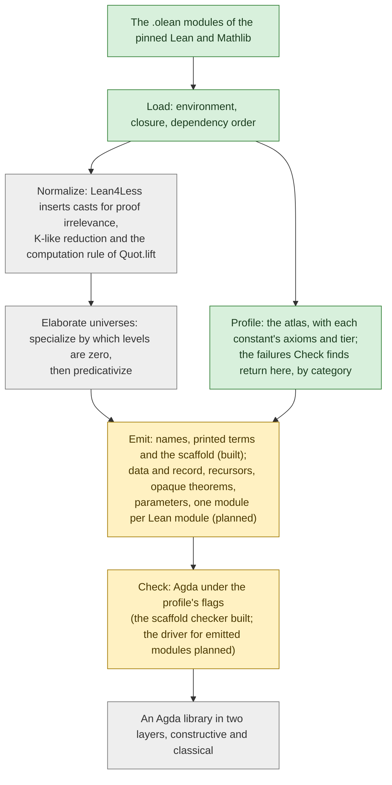

<!-- File: docs/architecture.md -->

# The translation pipeline

How lean2agda turns a Lean 4 library into an Agda library: the stages, what
each one consumes and produces, where each stood on 2026-10-13, and which
predecessor's idea each one uses.  This note is the companion of ADR 0001,
[`adr/0001-translation-architecture.md`][adr], which records the decisions and
the evidence that earned them; this note explains and decides nothing.  It is
written for a reader who knows type theory and one of the two proof assistants
but not this repository, and it defines each term where it is first needed.
The deep notes it summarizes stay beside their components:
[`translator/loading.md`][loading], [`translator/naming.md`][naming] and
[`translator/printing.md`][printing] for the stages built,
[`foundations/gap-catalog.md`][catalog] for the theory,
[`related-work.md`][related] for the predecessors, and the roadmap,
[`GITHUB_PROJECT.md`][roadmap], for the issues, which are cited here by number.

## Terms

+  A **profile** is a set of Agda flags the output must check under, plus what
   remains a module parameter.  There are four: U (`--type-in-type`, postulates
   allowed; scaffolding only, never a deliverable), K (`--safe` under Agda's
   default theory, in which K, the principle that any two proofs of an equality
   are equal, is available by pattern matching), CC
   (`--safe --cubical-compatible`, which implies `--without-K`) and CU
   (`--safe --cubical`).
+  A **tier** sorts a declaration by the axioms it depends on, computed
   exactly, the first rule that applies deciding: T3 if any axiom is outside
   the standard three, else T2 if `Classical.choice` is among them, else T1 if
   `propext` or `Quot.sound` is, else T0.
+  A **layer** is one of the two halves of an emitted library: the constructive
   layer holds tiers T0 and T1, and the classical layer holds T2 and imports
   the first; T3 is refused.
+  The **atlas** is the per-declaration record of what every constant of the
   pinned environment depends on (its axioms and tier, its kind and module, and
   the flags no axiom shows: `noncomputable`, `unsafe`, `partial`), from which
   the layering is computed; later versions add the kernel features a
   constant's typing used, the normalizer's casts, and its acceptance under
   each profile.
+  **Lean⁻** is Lean without two definitional rules: proof irrelevance (any two
   proofs of a proposition are definitionally equal) and K-like reduction (the
   recursor of a proposition with one field-free constructor, `Eq.rec` above
   all, reduces on any proof whose indices match the constructor's, not only on
   the constructor itself).  The **normalizer** is the stage that rewrites a
   Lean environment into a Lean⁻ one by inserting an explicit cast wherever the
   kernel used either rule; it computes no normal forms, and the roadmap's name
   is kept.
+  The **closure** of a declaration is every constant it reaches through types,
   values, constructors, recursors and their reduction rules, in dependency
   order; a **scaffold** is the Agda module the printer writes for a closure
   under profile U, every constant with its printed type as a postulate except
   the roots' values.
+  The **corpus** is the set of twelve declarations of Lean's core library and
   Mathlib translated into Agda by hand before the translator existed, each
   with its exported kernel term and notes on what the translation needed; it
   is the translator's test oracle ([`../corpus/README.md`][corpus]).
+  **Encoding A** and **encoding B** are the two candidate encodings of Lean's
   `Prop`: A maps each proposition to an h-proposition in `Set`, a type with a
   witness that any two of its elements are equal, and B maps it to Agda's
   `Prop` universe under `--prop`.  Issue [#27] decides between them.

## The pipeline at a glance

Lean's compiled modules go in; an Agda library in two layers comes out, and
Agda's verdict on it goes back into the atlas, which the diagram states in the
atlas's box rather than drawing.  The stages are the roadmap's five (Profile,
Normalize, Elaborate universes, Emit, Check), with the loading that precedes
them and the verification of Milestone 7 after them; the emitter is split into
the passes Milestone 2 builds.  A stage that exists on 2026-10-13 is green, one
partly built is yellow, and a planned one is grey.



| Stage | Consumes | Produces | Where it stands | Issues |
| --- | --- | --- | --- | --- |
| Load | the pinned `.olean` modules; a list of modules and of root declarations | an `Environment`; the closure of the roots in dependency order, each constant with its source module | built | [#15] |
| Profile | the environment | one record per constant (axioms, tier, kind, module, `noncomputable`, `unsafe`, `partial`, `auto`) and the report | built, version 0 | [#11]; [#36] adds the fields the later stages fill |
| Normalize | the environment of the modules to translate, through Lean4Less's `.olean` output or inside its process ([#26] chooses the bridge across the toolchain skew) | a Lean⁻ environment; the casts inserted per constant; the constants aborted | planned | [#26], [#30] |
| Elaborate universes | the Lean⁻ environment | each constant specialized by which of its universe-level parameters are zero, with predicative level annotations; the essentially impredicative constants, reported | planned | [#28], [#29] |
| Emit | the closure, the profile and the layer | Agda modules | names, the printer, the sharing pass and the profile U scaffold built; the rest planned | [#16] to [#22], [#27], [#32], [#33], [#37], [#38] |
| Check | the emitted modules and the profile's flags | Agda's verdict per module, with time and memory; the failures, fed back into the atlas by category | the scaffold checker and the corpus checker exist; the driver for emitted modules is planned | [#22], [#23], [#43], [#45] |

## Stage by stage

### Load

Built by [#15] (PR [#73]).  The command
`lake exe lean2agda MODULE... [-- DECL...]`, with the options `--profile U`,
`--root NAME`, `--out DIR`, `--share N` and `--stats`, run from `translator/`
inside the Nix shell, imports the named modules and their transitive imports
with Lean's `importModules`, from the pinned `.olean` files (Mathlib's come
from its cache, `make lean-cache`).  The roots are the declarations after `--`,
or every declaration the named modules own.  A pure function then computes the
closure: every constant's type and value, the structure names of projections
and the `Nat` and `String` types of literals, an inductive type's constructors,
mutual companions and recursors, a recursor's rules, the mutual companions of
definitions, and the whole quotient package whenever one of its constants is
reached.  Since an inductive type and its constructors depend on each other,
the closure is ordered by strongly connected components (Lean's Tarjan
algorithm), dependencies first and names sorted within a group.  The output is
the `Closure` API for the later passes and a diagnostic listing (`# group N`,
then kind, source module and name on each line); `Nat.gcd_self`'s closure has
334 constants in 278 groups.  The command line is lean4export's and lyphyser's
(`<mods> -- <decls>`).  Details: [`translator/loading.md`][loading].

### Profile: the atlas

Built by [#11] (PR [#71]); [#36] extends it.  `make atlas` runs
`lake exe atlas`, which imports all of Mathlib, builds the dependency graph of
the environment's 771,129 constants once and searches it backwards from each
axiom, so that every constant's axiom set is exact, then writes one NDJSON
record per constant (name, module, kind, axioms, tier, `lean_omits`,
`noncomputable`, `unsafe`, `partial`, `private`, `internal`, `auto`);
`scripts/python/atlas_report.py` then writes the report under `docs/reports/`.
The exact search replaces Lean's `collectAxioms`, which at the pin
under-reports 1,837 constants ([`lean-findings.md`][findings], LF-1); what Lean
leaves out is recorded in `lean_omits`.  The tier follows
[`../corpus/SCHEMA.md`][schema], and the layer rules of [#37] read it.  Version
1 ([#36]) adds the normalizer's cast counts and abort status, the
predicativization result, the K-essential flags and the acceptance under each
profile, which the Check stage feeds back.  Mathlib pull request 35685's script
and Mendoza-Smith's value graph were reproduced at their own revisions and
neither was copied; Batteries' test for auto-generated declarations was copied
with its notice.  Details: [`../atlas/README.md`][atlas].

### Normalize

Planned by [#26]; [#30] extends it.  Lean4Less ([`related-work.md`][related],
Lean4Less) is a modified Lean4Lean type checker that inserts a cast, justified
by a proof-irrelevance lemma and congruence lemmas, wherever the original
checker would have used proof irrelevance or K-like reduction; its output is a
Lean⁻ environment and `aborted.txt`, the constants it gave up on.  The project
is to run it as an external tool at its own toolchain (its `main` names Lean
v4.28.0-rc1, five minor releases behind the pin), restore or work around its
`.olean` output or run the translator inside its process, and record per
constant the casts inserted and whether translation was aborted, as atlas
fields; none of this exists yet.  Since the lemma `prfIrrel` is a theorem from
`propext`, a cast also adds `propext` to a constant's dependencies in Lean⁻,
which the atlas is to keep apart from the source's own axioms.  [#30] is to
extend the same device to the computation rule of `Quot.lift`, which Lean has
definitionally and the parameter record of profiles K and CC has only
propositionally: every definitional use would become a rewrite by the record's
`lift-β`.  Lean4Less's optional eliminations of structure-like reduction and
unit eta are to stay off, since Agda's records have eta.

### Elaborate universes

Planned by [#28] and [#29].  Two steps, in the order rocq-lean-import and
lyphyser's tool both chose.  First, each constant is specialized by which of
its universe-level parameters are zero, which decides which of its sorts are
`Prop` (`Sort 0`): lyphyser's level clauses and rocq-lean-import's `_instX`
duplicates, one per pattern of parameters instantiated at `Prop`, are the same
idea; instances are generated lazily as uses demand them, and within an
instance every `imax` reduces to `max` or to zero.  Second, predicative,
universe-polymorphic level annotations are computed by collecting the
constraints between levels and unifying them in the equational theory of
levels, Felicissimo and Blanqui's universe-polymorphic elaboration
(Predicativize), with constraint postponement, explicit `Level` binders in the
emitted signatures, and a file of hand-added constraints per constant, since
not every solvable problem has a most general unifier.  A constant whose
constraints have no solution is essentially impredicative and is reported, not
translated; the corpus met one, Mathlib's infimum of substructures
([`foundations/gap-report-corpus.md`][report], `impredicative-prop`).

### Emit

The emitter is a sequence of passes, built in Milestone 2 under profile U and
made faithful in Milestones 3 and 4, as follows.

+  **Names** (built by [#16], PR [#74]).  `agdaIdent` encodes a Lean `Name`
   component by component (`:` between components; `~` escapes for underscores,
   Unicode, numeric and empty components and Agda's keywords) into an
   identifier that is injective by construction; `agdaModule` prepends a root
   (a profile and, later, a layer) to the source module's components to make
   the Agda module path; a `.names.ndjson` sidecar beside each module maps
   identifiers back to structured names.  lyphyser's colon separator is kept
   and rocq-lean-import's collision indices are avoided.  Details:
   [`translator/naming.md`][naming].
+  **Printing and sharing** (built by [#17], PR [#77]).  The sharing pass first
   moves every closed subterm that occurs twice or more and has at least 32
   expression nodes into an auxiliary definition (`owner._share.k`),
   kernel-checked, so that the printed text stays near the size of the shared
   term.  The printer then turns each kernel expression into an Agda syntax
   tree, reading every argument's visibility from the head's type (through the
   kernel's `whnf` and `check`), repairing lambdas whose binder information
   differs from the type they are checked against, printing a definition's
   leading lambdas as left-hand-side patterns, naming binders by a readable
   base and their depth, and rendering by a precedence table.  Under profile U
   every sort prints as `Set`; literals go through `BUILTIN NATURAL` and
   `BUILTIN STRING`; `Expr.proj` prints through the structure's recursor until
   records exist.  lyphyser's deduplication and lambda binder fixing are the
   ideas, re-derived.  Details: [`translator/printing.md`][printing], with the
   measurements in [`reports/printing-blowup-2026-10-12.md`][blowup].
+  **The scaffold** (built by [#17]).  `--out DIR` writes one Agda module for
   the whole closure under `{-# OPTIONS --type-in-type #-}`: every constant a
   postulate of its printed type, except `Nat` and `String` (bound to their
   builtins), the type abbreviations, the roots' values and the auxiliaries.
   `scripts/python/scaffold_check.py` type-checks it, turning each refusal into
   a postulate or a drop and listing them, and golden listings pin where each
   scaffold stands.  All twelve corpus scaffolds print and scope-check.
+  **Inductive types and records** (planned by [#18]).  Structure-like
   inductives (one constructor, no indices, not recursive) become records with
   eta and the rest `data`; mutual and nested blocks are emitted directly.
   lyphyser emitted records "where possible".
+  **Recursors** (planned by [#19]).  Each kernel recursor becomes a function
   by pattern matching whose clauses are the recursor's rules, so that it
   computes as in Lean; `casesOn`, `recOn`, `below` and `brecOn` stay the
   definitions they are.  lyphyser's recursors are pattern-matching definitions
   too.
+  **Definitions, theorems, opaque constants and axioms** (planned by [#20]).
   Definitions stay transparent; theorems go in `opaque` blocks, with a
   fallback to transparency where a Lean term unfolds one; Lean's `opaque` is
   Agda's `opaque`; `partial` definitions are opaque constants with an
   inhabitant; axioms are postulates under U; `sorryAx` and `unsafe`
   declarations are refused.
+  **Quotients** (planned by [#21] under U, and by [#30] and [#52] faithfully).
   Under U the four primitives are postulates with a `REWRITE` rule for the
   computation of `Quot.lift`, which lyphyser's postulates lacked; under K and
   CC they are a seven-field parameter record (`Quot`, `mk`, `lift`, `ind`,
   `sound`, `lift-β`, `squash`) and the rule is propositional; under CU they
   are the cubical library's set quotients.
+  **Modules** (planned by [#22]).  One Agda file per Lean module, importing
   the images of the module's imports, with an `.agda-lib` file and an
   `Everything` module, so that Agda checks modules independently and in
   parallel and memory stays bounded.  lyphyser's single file ran Agda out of
   memory; hol2dk writes one file per theorem with an interface file.
+  **The encoding of `Prop`** (planned by [#27]).  Both encodings behind a
   switch, measured on the corpus and `Init`, decided in ADR 0002.  lyphyser
   used Agda's `Prop` and rocq-lean-import Rocq's `SProp`; agda-unimath and the
   cubical library speak encoding A.
+  **Parameters and layers** (planned by [#33], [#37] and [#38]).  The
   classical principles become record-typed module parameters in the style of
   TypeTopology, threaded so that a module takes only what its declarations
   need, with a `Postulated` module outside the `--safe` library for users who
   prefer postulates; the atlas's tier places each declaration in the
   constructive or the classical tree, under the roots [#37] fixes, and T3 is
   refused with a reason.  A hand-written constructive proof may promote a
   classical-layer theorem through the overlay of [#40], a module of such
   proofs, each checked against the generated statement and preferred by the
   emitter, with the promotion recorded in the atlas.
+  **Readability and size** (planned by [#46] and [#44]).  Lean's notation
   through Agda mixfix aliases, implicit arguments Agda can infer dropped and
   re-checked, docstrings carried over, a literate output; sharing across
   declarations and cast-chain simplification, with the blowup factor tracked
   in CI.

### Check

Today `make corpus-check` runs the shell's `agda` on every corpus entry under
the flags its files declare and prints a table
([`../corpus/README.md`][corpus], Checking), and
`scripts/python/scaffold_check.py` type-checks a scaffold.  [#22] adds the
driver for emitted modules, `scripts/python/agda_check.py`, which checks them
in dependency order with a configurable parallelism and records time and peak
memory per module; [#23] runs the corpus's golden outputs in CI and starts
`docs/performance.md`; [#43] and [#45] make checking affordable and
incremental.  Every failure goes back into the atlas with its category (a
translator defect, an essential impredicativity, a constant the normalizer
aborted, a K-essential use), which is what the faithfulness report of [#35] and
the layering of Milestone 4 read.

### Verification

Milestone 7 closes the loop.  The Lean Kernel Arena entry ([#56]) reads
lean4export's NDJSON into an environment without kernel checking, translates
under profile K and lets Agda's verdict decide, with a decline for what the
profiles cannot express; the format carries what the translator needs beyond
the bare terms, binder information and the recursors' `k` flag.  The
soundness-bug suite ([#58]) confirms that translation plus Agda rejects the
known kernel bugs, and the trust analysis ([#57]) names every component a user
trusts: the normalizer, the universe elaboration, the printer, the parameter
records' types, and Agda itself.

## Where each predecessor's idea is used

The survey ([`related-work.md`][related]) closes each predecessor's section
with what lean2agda takes from it, by issue; the table collects those lines by
stage, and adds three rows the roadmap's issue bodies supply: lyphyser's
command line for [#15], the TypeTopology library, and agda-unimath with the
cubical library.

| Predecessor | Idea | Where in the pipeline | Issues |
| --- | --- | --- | --- |
| lyphyser's lean2agda | reading the elaborated environment; the `<mods> -- <decls>` command line | Load | [#15] |
| | colon-separated namespaces | Emit: names | [#16] |
| | deduplication of repeated closed subterms; lambda binder fixing | Emit: printing and sharing | [#17] |
| | records for structure-like inductives; recursors by pattern matching | Emit | [#18], [#19] |
| | postulates for what the scaffolding cannot express | Emit, under U | [#20], [#21] |
| | level clauses | Elaborate universes, step 1 | [#28] |
| | one output file ran Agda out of memory | Emit: modules; term size | [#22], [#44] |
| | the postulated `Acc.rec` and `WellFounded.fixFEq` | Subsingleton elimination | [#32] |
| Lean4Less | the cast insertion and the name Lean⁻; per-constant counts of casts; the overhead baseline | Normalize; Profile | [#26], [#36] |
| lean2dk | the measured cost of printing shared terms as text; the three classes of stubbed constants | Emit: printing and sharing, term size; literals | [#17], [#44], [#31] |
| rocq-lean-import | duplication per pattern of universe parameters instantiated at `Prop`, that is, at level zero; surrogate parameters for algebraic universes | Elaborate universes | [#28], [#29] |
| | `Acc` as the hard case of subsingleton elimination | Subsingleton elimination | [#32] |
| | pathological conversion problems | Check: performance before any Mathlib-scale run | [#43], [#44] |
| Predicativize | universe-polymorphic elaboration with level unification; hand-added constraints | Elaborate universes, step 2 | [#29] |
| | a translated library that checks under `--safe` | profile K's existence proof | [#33] |
| lean4export and the Lean Kernel Arena | the NDJSON format as the Arena entry's input; the `bugs/` and `reject` tests | Verification | [#56], [#58] |
| hol2dk | one file per theorem with interface files; proof simplification before output; alignment to the target's standard library; provenance that regenerates what shipped | Emit: modules; term size; bridges; the library template | [#22], [#45], [#44], [#50], [#47] |
| TypeTopology | classical principles as record-typed module parameters | Emit: parameters | [#33], [#38] |
| agda-unimath and the cubical library | the h-proposition dialect (encoding A); set quotients under CU | Emit: the encoding of `Prop`; quotients | [#27], [#52] |
| Mathlib pull request 35685 and Mendoza-Smith | counts of dependence on `Classical.choice` | Profile | [#11] |

## Running what exists

Inside `nix develop`, from the repository root, as follows.

```sh
make doctor            # the toolchain: Lean 4.33.1, Agda 2.8.0 and its libraries
make lean-cache        # Mathlib's prebuilt .olean files, several gigabytes, once
make lean-build        # build the Lake package in translator/
cd translator
lake exe lean2agda --stats Init.Data.Nat.Gcd -- Nat.gcd_self    # the closure and its counts
lake exe lean2agda --out out Init.Data.Nat.Gcd -- Nat.gcd_self  # closure.txt, sidecars, scaffold
python3 ../scripts/python/scaffold_check.py --messages out/U/Init/Data/Nat/Gcd.agda
cd ..
make atlas             # the atlas and its report, about three minutes and 7.5 GiB
make corpus-check      # Agda on every corpus entry
make scaffold-corpus   # print and scope-check all twelve scaffolds, about half an hour
make test              # the Python suite and the translator's semantic and golden tests
```

## References

Issues are cited by number; the documents are this repository's.

[#11]: https://github.com/formalverification/lean2agda/issues/11
[#15]: https://github.com/formalverification/lean2agda/issues/15
[#16]: https://github.com/formalverification/lean2agda/issues/16
[#17]: https://github.com/formalverification/lean2agda/issues/17
[#18]: https://github.com/formalverification/lean2agda/issues/18
[#19]: https://github.com/formalverification/lean2agda/issues/19
[#20]: https://github.com/formalverification/lean2agda/issues/20
[#21]: https://github.com/formalverification/lean2agda/issues/21
[#22]: https://github.com/formalverification/lean2agda/issues/22
[#23]: https://github.com/formalverification/lean2agda/issues/23
[#26]: https://github.com/formalverification/lean2agda/issues/26
[#27]: https://github.com/formalverification/lean2agda/issues/27
[#28]: https://github.com/formalverification/lean2agda/issues/28
[#29]: https://github.com/formalverification/lean2agda/issues/29
[#30]: https://github.com/formalverification/lean2agda/issues/30
[#31]: https://github.com/formalverification/lean2agda/issues/31
[#32]: https://github.com/formalverification/lean2agda/issues/32
[#33]: https://github.com/formalverification/lean2agda/issues/33
[#35]: https://github.com/formalverification/lean2agda/issues/35
[#36]: https://github.com/formalverification/lean2agda/issues/36
[#37]: https://github.com/formalverification/lean2agda/issues/37
[#38]: https://github.com/formalverification/lean2agda/issues/38
[#40]: https://github.com/formalverification/lean2agda/issues/40
[#43]: https://github.com/formalverification/lean2agda/issues/43
[#44]: https://github.com/formalverification/lean2agda/issues/44
[#45]: https://github.com/formalverification/lean2agda/issues/45
[#46]: https://github.com/formalverification/lean2agda/issues/46
[#47]: https://github.com/formalverification/lean2agda/issues/47
[#50]: https://github.com/formalverification/lean2agda/issues/50
[#52]: https://github.com/formalverification/lean2agda/issues/52
[#56]: https://github.com/formalverification/lean2agda/issues/56
[#57]: https://github.com/formalverification/lean2agda/issues/57
[#58]: https://github.com/formalverification/lean2agda/issues/58
[#71]: https://github.com/formalverification/lean2agda/pull/71
[#73]: https://github.com/formalverification/lean2agda/pull/73
[#74]: https://github.com/formalverification/lean2agda/pull/74
[#77]: https://github.com/formalverification/lean2agda/pull/77

[adr]: adr/0001-translation-architecture.md
[loading]: translator/loading.md
[naming]: translator/naming.md
[printing]: translator/printing.md
[blowup]: reports/printing-blowup-2026-10-12.md
[catalog]: foundations/gap-catalog.md
[report]: foundations/gap-report-corpus.md
[related]: related-work.md
[roadmap]: GITHUB_PROJECT.md
[findings]: lean-findings.md
[corpus]: ../corpus/README.md
[schema]: ../corpus/SCHEMA.md
[atlas]: ../atlas/README.md
